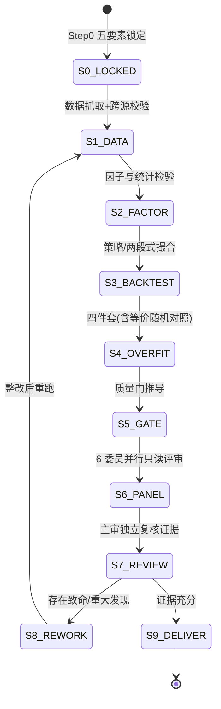

# 平台化技术架构设计（PLATFORM_ARCHITECTURE）

> 设计对象：把 `astock-quant-lab`（离线研究框架）升级为可部署、可验收的 **A 股量化研究平台**，交付到内网 ai-server `192.168.2.203`。
> 设计基线：2026-11-16 实测环境与 v3 代码状态。本文所有性能读数一律引用 `output/result.json` / `docs/metrics.md`，不转录数字。
> 合规边界：research-only，不含实盘下单、券商接口、自动交易循环；不荐股、不给买卖点与目标价、不承诺收益、不代操作。

---

## 0. 现状与硬约束（实测，不是假设）

### 0.1 目标环境 ai-server `192.168.2.203`

| 组件 | 端口 | 实测状态 | 本设计中的角色 |
|---|---|---|---|
| nginx | 80 | 在线，`/ai/*` 反代 | 前端静态托管 + `/quant/api/` 反代，**不新增对外端口** |
| AI 推理服务（FastAPI） | 80 `/ai` | 在线，OpenAPI 3.1 | 复用 `/ai/embed`、`/ai/upsert`、`/ai/search` 做文档向量检索 |
| embedding 模型 | — | `BAAI/bge-small-zh-v1.5`，`dim=512` | `vector(512)` 列宽由实测维度确定 |
| PostgreSQL 16 + pgvector | 5432 | 在线，库 `ai_db` | 主库，独立 schema `quant`；不新建实例、不引入第二套库 |
| SeaweedFS Filer | 8888 | 在线，匿名 PUT/GET 可用 | 交付物与 HTML 报告的对象存储（当前交付通道） |
| SeaweedFS S3 | 8333 | 匿名访问 403，需签名 | 仅作为后续可选通道，当前不依赖 |
| 宝塔面板 | 19008 | 在线 | 运维侧，平台不直接依赖 |
| **Agent 工作台（既有）** | **8093** | 在线，OpenAPI 3.1，nginx + FastAPI | **2026-11-17 新增实测**：4 角色任务队列，`ops` 带 `run_shell`、`dataops` 带 `sql_query`，历史任务事件含真实工具返回 → 内网存在**间接**执行通道；见 0.1.1 |
| SSH | 22 | OpenSSH 8.9p1 Ubuntu，需公钥或密码 | 本机无可用免密凭据；本次交付走 Filer，不阻塞 |
| MySQL 8 / Redis | 3306 / 6379 | 早期探测为关闭；2026-11-17 工作台巡检记录为监听 `0.0.0.0` | **不纳入架构**；队列用 PostgreSQL 表实现。两次探测口径不一致，已登记，不据此改设计 |

### 0.1.1 Agent 工作台 `:8093` 实测补充（2026-11-17）

用户给出 `http://192.168.2.203:8093/`。只读探测结论（`scripts/validate_workbench.py`，13/13，产物 `output/workbench_probe.json`）：

- 该服务是**内网既有的「Agent 工作台 · ai-server」**，不是本平台部署的页面；反向对照：本平台专属 `/quant/api/v1/health` 在 8093 返回 404。
- 契约有 `/api/health`、`/api/env`、`/api/roles`、`/api/tasks`(GET/POST)、`/api/tasks/{tid}/events`、`/api/tasks/{tid}/stream`、`/api/artifacts/{aid}/preview` 等；模型 `deepseek-chat`，产物落在 `/opt/agent-workbench/output`。
- 角色 `research` / `dataops` / `writer` / `ops`；`ops` 含 `run_shell`，`dataops` 含 `sql_query`。任务事件日志留有真实 `sql_query` / `run_shell` 返回（如 `SELECT ... FROM pg_database`、`uptime/free -h`），不是占位描述。
- 工作台既有巡检产物记载：PostgreSQL 16.15、连接身份 `ai_db` / `data_agent`、`public.embeddings` 含 `vector(512)` 与 `embeddings_hnsw_idx`（**pgvector 已装**）、但该账号对 `embeddings` 无 SELECT 权限、`count(*)` 被拒。

**对硬约束的影响（精确表述，不夸大）**：

1. 旧结论「内网服务器无可用的 Python 执行通道与数据库账号」**不再准确**，须修正为：**本机仍无 SSH 免密凭据、无直接数据库凭据；但内网存在经 Agent 工作台任务队列间接执行 shell 与 SQL 的通道**。二者是不同层面的事实，不可互相替代。
2. 该通道由**既有服务**提供、需经 `POST /api/tasks` 创建 LLM 任务来触发，属于对既有系统的写操作。本平台对该服务的调用限定为只读 GET；`POST /api/tasks` 任务创建、DDL 建表、nginx 与 `/ai/*` 配置变更均列入 M1/M2 的运维侧实施项，本版本不执行。M1 的 `quant` schema 与 M2 的常驻后端仍须由运维侧授权后独立部署。
3. `vector(512)` 与 `schema.sql` 的列宽一致，pgvector 依赖不再是未知项；但账号权限不足（`data_agent` 连既有表都无 SELECT），**DDL 可执行性仍未经本平台验证**，M0 验收门「DDL 在 PG 16 执行通过」不放宽。
4. 该工作台的角色/任务/事件/产物模型可作为 M4 编排的**候选宿主调研对象**，但它的任务模型没有 `run_id / stage / role / attempt` 幂等键与证据校验，不能替代本设计的 `agent_task` / `agent_message` 表；是否复用须经 M4 独立评估。

### 0.2 现有工程状态

- `astock-quant-lab`：纯 pandas + numpy 离线流水线，`python -m quantlab run` 产出 `result.json`、`SUMMARY.md`、`equity.csv`、`trades.csv`、两份 HTML 报告。
- 25 项单测；`metric-fingerprint` 把 38 个关键读数绑定到 HTML 与 `docs/metrics.md`；`python -m quantlab verify` 做交付前一致性校验。
- 质量门裁决：**工程可交付 / 策略结论不放行**（4 条硬否决）。平台化**不改变**该裁决，也不得因加了 Web 层就自动放行。
- 已有机制：预注册与样本外使用次数持久化、等价随机对照、7 轴参数敏感性、配置接线审计、双价格口径。

### 0.3 设计硬约束

1. **数值单一来源**：任何绩效读数只能来自 `result.json`，API 与前端不得自行重算；响应必须带 `metric_fingerprint`。
2. **引擎零 Web 依赖**：`quantlab` 包保持纯 Python 库，FastAPI 只是适配层，便于 CI 继续跑 `selftest → run → verify`。
3. **内网离线**：ECharts、字体、图标全部本地打包，禁止 CDN；无公网请求。
4. **只读为主**：默认所有 GET 只读；触发运行的写操作需 `run_id` 幂等键并写审计表。
5. **不改 `/ai/*` 契约**：新平台用 `/quant/api/v1/*` 并列，复用但不侵入现有 AI 服务。

---

## 1. 前后端选型

### 1.1 决策表

| 层 | 选型 | 被否方案与否决理由 |
|---|---|---|
| 前端框架 | **Vue 3 + TypeScript + Vite** | React 18：可行，但本项目图表密集、ECharts 与 Vue 的组合封装成本更低；团队现有报表页可直接迁移 |
| 图表 | **ECharts 5，本地 npm 打包** | CDN 引入：内网无外网，验收时会白屏；Chart.js：极坐标/热力图/多轴净值图表达力不足 |
| UI 组件 | **Naive UI** | Element Plus：默认字体依赖外部资源；Naive UI 纯 CSS-in-JS，离线可控 |
| 状态 / 路由 | Pinia + Vue Router 4 | 全局单例 store：运行任务多、页面多，缺少缓存与回滚边界 |
| 后端框架 | **FastAPI (Python 3.13) + Uvicorn** | Flask：缺 Pydantic 契约与自动 OpenAPI；Django：ORM 与现有 `result.json` 文件契约重复；Node 后端：与 quantlab 跨语言，需再写一层 IPC |
| 任务执行 | **独立 worker 进程 + PostgreSQL 队列表** | Celery + Redis：Redis 端口实测不可达；进程内 BackgroundTasks：回测约需数分钟，重启会丢任务 |
| ORM / 迁移 | SQLAlchemy 2.x + Alembic | 裸 SQL：迁移不可追溯；Django ORM：与 FastAPI 栈冲突 |
| 静态托管 | nginx :80 的 `/quant/` 路径 | 另起前端端口：内网端口策略不开放，且多一个入口 |
| 对象存储 | SeaweedFS Filer :8888 | 本地磁盘：无法跨机验收；S3 :8333：匿名 403，需签名配置 |

### 1.2 分层与数据流

```
浏览器 ──nginx :80──> /quant/            Vue3 静态产物（离线 ECharts）
        └──────────> /quant/api/v1/*     FastAPI（只读查询 + 触发运行）
                          │
        ┌─────────────────┼──────────────────┐
        ▼                 ▼                  ▼
  PostgreSQL quant.*   quantlab 引擎      /ai/*（embed/upsert/search）
  (指标/运行/审核/队列)  (worker 进程内调用)  (文档向量，只读旁路)
        │
        ▼
  SeaweedFS Filer :8888  ← 交付包、HTML 报告、验收页
```

**关键隔离**：`/ai/search` 的检索结果只用于「历史审核意见/文档问答」，**不得进入质量门或任何绩效读数**。质量门的输入只能是 `result.json` 与进程内自检结果。

### 1.3 前端页面与数据来源

| 页面 | 主要接口 | 说明 |
|---|---|---|
| 运行总览 | `GET /runs`、`GET /runs/{id}/metrics` | 展示指纹、质量门两票、硬否决项；数值全部来自后端 |
| 净值与回撤 | `GET /runs/{id}/equity` | ECharts 多轴；不在前端计算夏普或回撤 |
| 因子研究 | `GET /runs/{id}/factors` | IC / HAC t / BH-FDR 表格，方向反转显式标注 |
| 过拟合四件套 | `GET /runs/{id}/overfit` | 等价随机对照分位、参数敏感性、DSR、成本敏感性 |
| 质量门 | `GET /runs/{id}/quality-gate` | 18 项逐条 `ITEM / VERDICT / EVIDENCE / NOTE` |
| 专家团审核 | `GET /audit/{run_id}/opinions` | 6 位委员意见 + 主审复核结论，带证据路径 |
| 交付与验收 | `GET /deliveries` | 交付物清单、sha256、内网 URL、验收清单状态 |
| 研报原文 | `GET /reports/{id}/design\|audit` | 保留 `metric-fingerprint` 的 HTML，iframe 嵌入 |

---

## 2. 数据库建模

### 2.1 总体原则

- 复用 `ai_db`，新建 schema `quant`，与现有 AI 服务表物理隔离、逻辑可联查。
- **事实表不可变**：一次 `run` 的 `result.json` 原始副本、`config_snapshot` 落库后不更新；修正通过新 `run_id` 表达。
- **指标采用路径表**：38 个关键路径存 `run_metric(path, value_text, value_num)`，与 `METRIC_PATHS` 一一对应，让 `verify` 与数据库可双向核对。
- **双价格口径用列区分**：`price_basis ∈ {qfq, raw}`，同一 `(instrument_id, trade_date, price_basis)` 唯一，禁止混算。
- **向量列宽 512**：与实测 embedding 维度一致；向量只存文档分块，不存数值指标。
- 完整 DDL 见 `db/schema.sql`。

### 2.2 实体关系（文字版）

```
instrument 1───* price_bar          (行情，按 price_basis 区分)
instrument 1───* factor_value        (因子值，按 factor_code 区分)
factor_definition 1───* factor_value
research_run 1───* run_metric
research_run 1───* backtest_trade
research_run 1───* equity_point
research_run 1───* quality_gate_item
research_run 1───* audit_opinion
research_run 1───1 quality_gate_verdict
research_run 1───* delivery_artifact
preregistration 1───* research_run   (冻结假设 → 多次运行)
agent_task *───1 research_run        (编排任务，带 attempt)
agent_task 1───* agent_message
document_chunk (vector(512)) 独立，按 run_id / doc_type 过滤
```

### 2.3 核心表与关键字段

| 表 | 主键 | 关键字段 | 约束与用途 |
|---|---|---|---|
| `quant.instrument` | `instrument_id` | `code`(6位唯一)、`name`、`board`、`industry`、`is_st`、`listed_date` | 行业缺失填 `UNKNOWN`，不得猜测 |
| `quant.price_bar` | `(instrument_id, trade_date, price_basis)` | OHLCV、`amount`、`prev_close`、`limit_up/down`、`can_buy/can_sell` | 双口径唯一键；涨跌停基准由 `raw` 行派生 |
| `quant.factor_definition` | `factor_code` | `formula`、`direction_sign`、`weight`、`enabled` | 方向锁 +1，禁止据样本反号 |
| `quant.factor_value` | `(run_id, trade_date, code, factor_code)` | `raw_value`、`zscore`、`rank_pct` | 与 `eligible` 掩码一致 |
| `quant.research_run` | `run_id` (UUID) | `config_snapshot` JSONB、`config_hash`、`metric_fingerprint`、`status`、`started_at/finished_at`、`git_sha` | 不可变事实；`status` 用枚举状态机 |
| `quant.run_metric` | `(run_id, metric_path)` | `value_text`、`value_num`、`source` | 只存 `METRIC_PATHS` 内路径 |
| `quant.backtest_trade` | `(run_id, seq)` | `trade_date`、`code`、`side`、`shares`、`price_basis`、`gross`、`commission`、`stamp_tax`、`slippage`、`cash_after` | 逐笔记账；`cash_after >= 0` 检查约束 |
| `quant.equity_point` | `(run_id, trade_date)` | `equity`、`cash`、`exposure`、`drawdown`、`fuse_level` | 逐日现金/敞口，供验权重放 |
| `quant.quality_gate_item` | `(run_id, item_key)` | `verdict`、`evidence` JSONB、`note`、`hard_fail` | 18 项逐条可追溯 |
| `quant.quality_gate_verdict` | `run_id` | `engineering_gate`、`strategy_conclusion_gate`、`final_verdict`、`hard_fail_items` JSONB | 两票分开，禁止互相顶替 |
| `quant.preregistration` | `prereg_id` | `hypothesis_hash`、`strategy_hash`、`oos_use_count`、`oos_max_uses`、`frozen` | 与 `state/research_state.json` 同步 |
| `quant.audit_opinion` | `(run_id, panelist, attempt)` | `verdict`、`evidence_path`、`summary`、`evidence_valid` | 无证据路径的意见不计票 |
| `quant.agent_task` | `task_id` | `run_id`、`stage`、`role`、`status`、`input_hash`、`output_hash`、`attempt` | 幂等 `(run_id, stage, role, attempt)` 唯一 |
| `quant.agent_message` | `message_id` | `task_id`、`direction`、`payload` JSONB、`created_at` | 编排留痕，可重放 |
| `quant.document_chunk` | `chunk_id` | `run_id`、`doc_type`、`content`、`embedding vector(512)`、`metadata` JSONB | HNSW 索引；由 `/ai/embed` 生成 |
| `quant.delivery_artifact` | `artifact_id` | `run_id`、`path`、`sha256`、`size`、`storage_url`、`verify_status` | 验收清单的数据源 |

### 2.4 索引与完整性

- `price_bar` 按 `trade_date` 索引；规模上到全 A 时按年做声明式分区。
- `run_metric` 的 `metric_path` 建 B-tree；`research_run.metric_fingerprint` 唯一索引（同一次结果只允许一条运行记录，防重复入库）。
- `document_chunk.embedding` 建 `hnsw (vector_cosine_ops)`，`WHERE run_id = ?` 与 `doc_type` 组合过滤。
- `backtest_trade` 加 `CHECK (cash_after >= -0.000001)`，把「纯多头、无杠杆」硬约束下沉到数据库层。
- 所有写操作经 `research_run` 关联，禁止直接改 `result.json` 派生表；修正走新 `run_id`。

---

## 3. 智能体编排

### 3.1 角色与职权

| 角色 | 职权 | 禁止事项 |
|---|---|---|
| `orchestrator` 主审 | 分派阶段、复核证据、汇总裁决、触发交付 | 不得替委员写意见；不得自行改 `final_verdict` |
| `quant-workflow` 主席 | 流程完整性、Step 0 五要素 | 不得给绩效结论 |
| `strategy-architect` | 策略规格与参数一致性 | 不得据样本反号 |
| `factor-researcher` | IC/HAC/FDR 方法正确性 | 不得用 iid t 替代 HAC |
| `backtest-engineer` | 撮合、现金/敞口、T+1、blocked 留痕 | 不得跳过逐日断言 |
| `risk-modeler` | 熔断、压力、beta、容量定级 | 不得把假设情景标成事实 |
| `reality-check` | 文档漂移、合规、缺口登记 | 不得放行无证据结论 |
| `delivery-agent` | 打包、上传、生成验收清单、回执 | 不得修改 `result.json` |

### 3.2 阶段状态机（DAG，不允许自由跳转）



- `S6_PANEL` 是 6 路并行只读，任何委员不得写工程文件。
- `S7_REVIEW` 必须主审亲自重放证据（本项目已发生过一次：v1 的负现金/隐性杠杆由独立重放 `trades.csv` 证实，才推翻原判定）。
- `S8_REWORK → S1_DATA` 表示整改后**全流程重跑**，不是局部补丁；新 `run_id` 递增。

### 3.3 任务与消息契约

```json
{
  "task_id": "uuid",
  "run_id": "uuid",
  "stage": "S6_PANEL",
  "role": "backtest-engineer",
  "attempt": 1,
  "input_hash": "sha256(...)",
  "payload": {
    "read_only": true,
    "allowed_paths": ["output/result.json", "output/trades.csv", "quantlab/engine.py"],
    "required_evidence": ["metric_path_or_file_line"]
  },
  "deadline_policy": "queue_poll",
  "idempotency_key": "run_id:stage:role:attempt"
}
```

委员回执：

```json
{
  "task_id": "uuid",
  "verdict": "成立 | 不成立 | 存疑",
  "opinions": [
    {
      "item": "逐日现金约束",
      "evidence_path": "output/trades.csv: cash_after",
      "evidence": "重放得到最小现金与最大敞口",
      "severity": "致命 | 重大 | 一般"
    }
  ],
  "output_hash": "sha256(...)"
}
```

**证据规则**：`evidence_path` 为空的意见写 `evidence_valid=false`，不进入计票。所有回执写 `agent_message` 表，可用 `(run_id, stage, role, attempt)` 重放。

### 3.4 调度实现

- Redis 不可达，因此用 `quant.agent_task` 表作队列：worker 用 `SELECT ... FOR UPDATE SKIP LOCKED` 领取，写 `status` 与 `output_hash`，保证至多一次生效。
- 6 路委员评审并行；其余阶段串行。
- 与 `/ai/*` 的集成：`document_chunk` 先经 `POST /ai/embed` 得 512 维向量，再 `/ai/upsert` 入库；历史审核意见通过 `/ai/search` 检索作参考。检索结果标记 `advisory=true`，质量门忽略该字段。

---

## 4. 接口契约

### 4.1 通用约定

- 前缀 `/quant/api/v1`，OpenAPI 3.1，完整定义见 `contracts/openapi.yaml`。
- 统一响应信封：`{ "code": 0, "message": "ok", "data": ..., "request_id": "...", "run_id": "...", "metric_fingerprint": "..." }`。
- 所有含数值的响应必须携带 `metric_fingerprint`；指纹不匹配时前端显示「数据已变更，请刷新」，不展示旧读数。
- 触发类接口要求 `Idempotency-Key` 头；重复键返回原 `run_id`，不重复启动回测。
- 列表接口统一 `?limit=&cursor=`，游标基于 `(created_at, id)`，禁止深分页 OFFSET。
- 错误码：`4001` 参数校验失败、`4041` 运行不存在、`4091` 状态机不允许的跃迁、`4221` 配置非法、`5001` 引擎执行失败、`5031` 依赖服务（PostgreSQL / ai-server）不可用。

### 4.2 端点清单

| 方法 | 路径 | 用途 | 幂等 |
|---|---|---|---|
| GET | `/health` | 存活 + 依赖探针（PG、Filer、`/ai/health`） | — |
| GET | `/runs` | 运行列表（状态、指纹、git_sha） | — |
| POST | `/runs` | 触发一次完整流水线 | `Idempotency-Key` |
| GET | `/runs/{run_id}` | 运行详情 + `config_snapshot` | — |
| GET | `/runs/{run_id}/status` | worker 状态轮询 | — |
| GET | `/runs/{run_id}/result` | 原始 `result.json` 只读副本 | — |
| GET | `/runs/{run_id}/metrics` | 38 个关键路径指标 | — |
| GET | `/runs/{run_id}/equity` | 净值/现金/敞口/回撤序列 | — |
| GET | `/runs/{run_id}/trades` | 成交逐笔 | — |
| GET | `/runs/{run_id}/factors` | 因子 IC / HAC t / FDR | — |
| GET | `/runs/{run_id}/overfit` | 过拟合四件套 | — |
| GET | `/runs/{run_id}/quality-gate` | 18 项 + 两票 + 硬否决 | — |
| GET | `/audit/{run_id}/opinions` | 6 委员意见 + 主审复核 | — |
| POST | `/audit/{run_id}/panels` | 发起专家团评审（触发类） | `Idempotency-Key` |
| GET | `/preregistration` | 冻结假设、`oos_use_count` | — |
| POST | `/preregistration` | 写入假设（`--force` 语义） | `Idempotency-Key` |
| GET | `/verify/{run_id}` | 一致性校验结果（指纹/标记/陈旧值） | — |
| GET | `/reports/{run_id}/design` | 设计报告 HTML | — |
| GET | `/reports/{run_id}/audit` | 联合审核报告 HTML | — |
| GET | `/deliveries` | 交付物清单、sha256、内网 URL | — |
| POST | `/deliveries` | 生成并上传交付包（触发类） | `Idempotency-Key` |
| GET | `/agents/tasks` | 编排任务状态 | — |
| POST | `/agents/tasks/{task_id}/callback` | 委员回执（须带证据路径） | `Idempotency-Key` |

### 4.3 契约不变量

1. 前端不得出现计算绩效的代码；任何数字字段都可追溯到 `metric_path`。
2. `final_verdict` 由后端质量门推导，接口只返回，不提供写接口。
3. `/ai/*` 保持原样；平台通过 HTTP 客户端调用，不共享数据库表结构。
4. OpenAPI 变更需同时更新 `contracts/` 下的 JSON Schema 与前端生成类型；CI 中做契约一致性检查。

---

## 5. 目录结构

```
ai-quant-platform/                    # 平台化 monorepo（由现有 astock-quant-lab 演进）
├── apps/
│   ├── web/                          # Vue3 + TS + Vite 前端
│   │   ├── src/
│   │   │   ├── pages/                # 总览/净值/因子/过拟合/质量门/审核/交付
│   │   │   ├── components/           # ECharts 封装（本地打包，无 CDN）
│   │   │   ├── api/                  # 由 openapi.yaml 生成的类型化客户端
│   │   │   └── stores/               # Pinia
│   │   └── vite.config.ts
│   └── api/                          # FastAPI 服务
│       ├── main.py
│       ├── routers/                   # runs / metrics / audit / deliveries / agents
│       ├── schemas/                   # Pydantic（与 contracts 对齐）
│       ├── deps.py                    # PG 会话、依赖探针、幂等键
│       └── worker.py                 # 队列轮询 + quantlab 调用
├── packages/
│   ├── quantlab/                     # 【现有】纯 Python 引擎，零 Web 依赖
│   │   ├── data.py factors.py strategy.py engine.py risk.py
│   │   ├── pipeline.py analytics.py report.py
│   │   ├── state.py fingerprint.py verify.py
│   │   └── cli.py
│   ├── agents/                       # 编排器与角色定义
│   │   ├── orchestrator.py
│   │   ├── roles/                    # 6 委员 + delivery-agent
│   │   └── evidence.py               # 证据校验（无证据不计票）
│   └── contracts/                    # 【契约单一来源】
│       ├── openapi.yaml
│       ├── schemas/                   # JSON Schema
│       └── generated/                 # TS 类型（脚本生成，禁手改）
├── db/
│   ├── schema.sql                    # 本设计 DDL
│   └── migrations/                   # Alembic 版本
├── config/
│   └── default.json                 # 【现有】Step 0 与全部参数唯一入口
├── data/sample_real/
│   ├── prices.csv                    # 前复权
│   └── prices_raw.csv                 # 未复权（仅涨跌停基准）
├── docs/
│   ├── PLATFORM_ARCHITECTURE.md     # 本文
│   ├── ARCHITECTURE.md               # 现有离线引擎架构
│   ├── DATA_CONTRACT.md / STRATEGY_SPEC.md / QUALITY_GATE.md
│   ├── DEVELOPMENT_v3.md / metrics.md
│   ├── ACCEPTANCE.md                # 验收清单
│   └── *.html                        # 设计报告 / 联合审核报告
├── deploy/
│   ├── nginx/quant.conf             # /quant/ 与 /quant/api/ 反代
│   ├── systemd/quant-api.service
│   └── deliver.sh                    # 打包 + Filer 上传 + 回执
├── scripts/                          # 【现有】抓取/报告/校验脚本
├── tests/                            # 【现有】25 项单测 + 新增 API/契约测试
├── output/                           # 【现有】结果产物，纳入版本控制
└── state/research_state.json         # 【现有】预注册状态
```

**迁移映射**：现有 `astock-quant-lab/quantlab/` 原样成为 `packages/quantlab/`；`docs/` 原样保留；`scripts/`、`tests/`、`output/`、`config/`、`state/` 保持路径不变，避免 `verify.py` 中的 `ROOT` 相对路径失效。新增 `apps/`、`packages/agents/`、`packages/contracts/`、`db/`、`deploy/`。

---

## 6. 里程碑与验收门

| 里程碑 | 目标 | 可验收物 | 验收门（不满足不进下一阶段） |
|---|---|---|---|
| **M0 契约冻结** | 锁定 Step 0、接口契约、DDL | `config/default.json`、`contracts/openapi.yaml`、`db/schema.sql`、本文 | OpenAPI 可解析；DDL 在 PG 16 执行通过；`vector(512)` 与实测维度一致 |
| **M1 数据层** | 行情/指标入库，双价格口径落库 | 迁移脚本、`price_bar` 双口径数据、`run_metric` 与 `result.json` 对账脚本 | 38 个 `metric_path` 逐项一致；`cash_after >= 0` 约束生效；行数与原始 CSV 口径可解释 |
| **M2 引擎适配** | FastAPI 包装 quantlab，worker 可跑全流程 | `/runs`、`/runs/{id}/status`、`/metrics`、队列表 | 现有 25 项单测全通过；`selftest → run → verify` 在 worker 中结果一致；`metric_fingerprint` 不变 |
| **M3 前端与报告** | 8 个页面上线，报告嵌入 | Vue3 产物、`/quant/` 可访问、ECharts 离线渲染 | 无任何 CDN 请求；页面数字与 `/metrics` 完全一致；HTML 报告指纹保留 |
| **M4 智能体编排** | 6 委员并行评审 + 主审复核可重放 | `agents/`、`agent_task`/`agent_message`、证据校验 | 无证据意见不计票；`(run_id, stage, role, attempt)` 可重放；质量门裁决不被 advisory 字段影响 |
| **M5 交付与验收** | 内网交付、验收清单、回执 | 交付包、Filer URL、验收页、`delivery_artifact` 记录 | 每个交付物有 sha256 且可下载；验收清单逐项可勾选；`verify` 通过 |

**并行关系**：M1 与 M2 可并行；M3 依赖 M2 的契约稳定；M4 依赖 M2/M3；M5 是闸门，任何阶段未过门不得进入。

**风险登记**：
- PostgreSQL 5432 可达、pgvector 已装（`vector(512)` + HNSW 见 0.1.1）；但已知的 `data_agent` 账号连 `public.embeddings` 都无 SELECT 权限，**无可用于 `quant` schema 建表的授权凭据** → M1 前仍需运维提供专用读写账号；DDL 先在本地校验语法，M0 验收门不放宽。
- SSH 无免密凭据 → 交付走 Filer :8888；nginx 配置变更需运维侧执行 `deploy/nginx/quant.conf`。`:8093` 工作台虽能间接执行 shell，但触发它需向既有服务提交 LLM 任务（写操作）；本平台对该服务的调用限定为只读 GET，任务创建与配置变更列入 M1/M2 的运维侧实施项。
- `/ai/*` 与 `:8093` 均为既有服务 → 平台只读调用，不改变其契约；不可用时 `/health` 降级为 `degraded`，不阻断回测主链路。
- 质量门当前为「策略结论不放行」→ 平台上线**不解除**该判定，前端必须显式展示硬否决项。

---

## 7. 与本次内网交付的关系

本次交付对应 **M0 的架构工件 + M5 的交付动作**：架构文档、OpenAPI 契约、DDL、验收清单随工程一起打包，上传到 `192.168.2.203` 的 SeaweedFS Filer，用户可直接打开 HTML 验收页逐项核对。M1～M4 属于后续实现阶段，本文给出的是可执行的选型、建模、编排与契约定义，不是占位描述。

**合规**：research-only；回测结果不等于实盘表现，历史业绩不代表未来；不荐股、不给买卖点与目标价、不承诺收益、不代操作。
