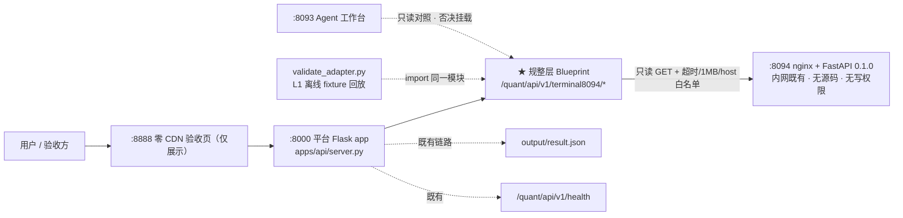

# :8094 改造评估 · 架构定稿 v1.2 FINAL

> 团队：`terminal-8094-review` · 系统架构师：梁承宇 · 状态：**Phase 1 架构侧定稿，唯一有效版本**
> 上游依据：`docs/TERMINAL_8094_EVIDENCE.md`、`output/terminal_8094_probe.json`（**32/32**，反向对照 0/32）
> 裁决依据：`docs/TERMINAL_8094_PHASE1.md`（主理人裁决 1–5、决策与权衡汇总）+ 主理人终裁（错误体 B 支 / F1 分阶段 / 指纹双对象分工）
> 版本沿革：v1.0 全文 → v1.1（F1 定性 / F7 条件性 / 449KB 性能约束）→ v1.2（字段集 / 部署 / 裁剪）→ **v1.2 FINAL（本稿：合并裁决 1–5、事实基线更正与主理人终裁）**。此前各版增量原文作废，以本文件为准。
> 合规边界：research-only。不荐股、不给买卖点与目标价、不承诺收益、不代操作；不改写上游选股结果，0 环节交智能体。

---

## 0. 定稿说明与事实基线

### 0.1 硬边界（决定架构形态的前提）

- 无 :8094 源码、无服务端写权限；本机无 SSH 免密与直接 DB 凭据。
- :8093 虽可间接执行 shell/SQL，但需 `POST /api/tasks` 触发 LLM 任务（写操作），本平台对其保持只读 GET。
- 故改造交付形态 = **本地可运行的契约规整层原型 + 确定性验收校验 + 评估报告 + 接入本平台验收页**，不改动 :8094 服务端。

### 0.2 证据基线

上游取证器 `scripts/validate_terminal_8094.py` 已由 27/27 更新为 **32/32**（反向对照 0/32），机读证据 `output/terminal_8094_probe.json`。成员旧稿中的「27/27」一律作废。

### 0.3 事实基线更正（主理人实测，覆盖本稿中任何旧表述）

1. **F5 不是「不可复算」——本版最重要的定性反转**。全样本反推确认前向收益算法 `fwd_h = close[t+h] / open[t+1] - 1`（信号次日开盘买入）：5/20/60 日三周期 n = 413 / 412 / 407，T+1 开盘口径最大绝对误差 **4.996e-05**（仅 4 位小数舍入），收盘到收盘口径平均误差约 **0.007**。算法自洽、可独立复算。**真实缺口是两项披露问题**：①契约未披露该口径；②日线硬截断 2000 根（首根 2018-08-16）与 `meta.universe_start = 2015-06-01` 不符。因此改造建议为**补披露**，不是改算法、也不是标 `UNVERIFIABLE`。本稿已全文移除旧稿「不可复算 / UNVERIFIABLE」表述。
2. **F2 精确机制**：上游按分号逐条解析 `conds`，无效项**静默丢弃**；全部无效时退化为默认选股清单。`conds` 通道本身有效（前端 6 个预设正是把字符串填进 `#cond-input` 再以 `conds` 提交）。注入型字符串**未被求值，不构成安全漏洞**。缺陷是「失败时无反馈 + 无声降级」，即决策误导而非注入面。故规整层的安全判据是「显式失败」而非「拦注入」（见 §4）。
3. **F7 是条件性风险**：`cdn.jsdelivr.net` / `fonts.googleapis.com` 本次实测**可达**（187,956 B / 1,103,471 B / 209 B），故为「内网隔离或离线时会白屏」，不是现状已坏。
4. **上游延迟实测 P95**（12 次采样，供端到端预算校准）：见 §4.1。8s 端到端预算充裕；`days` 边界拦截放在上游调用之前，避免 449 KB 大响应。
5. **F1 定性**：是 OpenAPI 契约层面失真（声明 `preset` 而后端不消费），不是功能故障；前端 `conds` 通道有效。按裁决 1，本期只做契约卫生（§3.8）。

### 0.4 本版相对旧稿的变更清单

| # | 变更 | 依据 |
|---|---|---|
| 1 | 错误体改**简化支 B**：`error.code=INVALID_CONDS`、`data=None`、取消顶层 `error_code` 与别名双写、取消 `fail_8094()` 薄封装、直接复用 `server.fail()`；取值固定进 `ErrorEnvelope.error.code` enum | 终裁 2.1 / 裁决 3 |
| 2 | F1 六键 PRESETS 映射**移出 M2**，本期不写代码、不写验收用例；改为「不声明 `preset` + 回显 `applied_conds`」，映射登记为条件触发后续项 | 终裁 2.2 / 裁决 1 |
| 3 | F5 定性反转：补披露，移除 `UNVERIFIABLE`；`/api/stock` 与风险表、演进表同步改写 | 裁决 4 |
| 4 | probe 32/32；上游 P95 实测入表，移除性能判据的【待确认】 | 裁决 4 |
| 5 | L1 离线 / L2 在线双层验收；L2 挂载探针写死 `/meta`，禁止探 `/terminal8094/health` | 裁决 2、裁决 5 |
| 6 | 降级统一严格模式（`data` ∈ {None, []}，不返回样例选股结果）；fixture 仅作 L1 离线回放 | 裁决 3 + §5-5 |
| 7 | **指纹双对象分工（终裁采纳，实施硬约束）**：`metric_fingerprint` 为继承恒量，**仅**用于「继承能力自检」；`provenance.payload_fingerprint` 由规范化 payload 生成，**仅**用于「可复跑」两次相等断言；**禁止**用前者做相等断言（恒真检查） | 终裁 1.4 |
| 8 | ST 处理 = 默认排除 + 开关；F4 不强制全样本展示，双口径并置即可 | 裁决 5 |

---

## 1. 架构总览

### 1.1 现状架构与插入点



四者关系：用户 ↔ :8888 零 CDN 静态页 ↔ :8000 平台（Flask + `/quant/api/v1`）属**本平台可控域**；:8094 是**外部只读依赖**；:8093 仅作旁路只读对照。**插入点 = :8000 内部、`/quant/api/v1` 之下的 Blueprint 层**：上不改 :8094，下复用 `server.envelope()` / `server.fail()` / `API_PREFIX` / `_IDEMPOTENCY`。

### 1.2 部署形态裁决（主理人裁决 5）

**常驻，但不是「新增常驻 HTTP 服务」**：规整层挂进 :8000 既有 Flask app 的 Blueprint，路由前缀 `/quant/api/v1/terminal8094`，**不新增进程、不新增 health 端点、不新增生命周期**，复用平台既有 `/quant/api/v1/health`。

- **否决挂 :8093**：只读 GET 硬边界 + 需 `POST /api/tasks` 触发 LLM 写操作，破坏 research-only 并引入不可控外部依赖。
- **否决新增反向代理常驻服务**：新增进程与生命周期，1 人团队无必要，且「零新增功能」原则不允许。
- **否决纯离线快照作为主形态**：数据陈旧、无法验证在线契约；但保留为 L1 验收夹具 / 离线回放通道。
- :8888 验收页仅做展示与触发，不承载 Python 逻辑。

**双通道、单一实现**：同一套 `apps/api/terminal8094/*` 模块，在线由 Blueprint 调用、离线由 `scripts/validate_adapter.py` import + fixture 回放做确定性验收。评审环境直连不到内网也能跑，且不产生两套逻辑漂移。

### 1.3 模块清单与职责

| 模块 | 职责 | 依赖 | 技术栈 |
|---|---|---|---|
| `blueprint.py` | 路由挂载、参数边界校验、`conds`/`preset` 互斥（本期不声明 preset）、`bp.after_request` 统一注入 disclaimer、**上游访问参数化入口** | → 下列各模块、`server.envelope/fail/API_PREFIX` | Flask Blueprint |
| `client.py` | 上游只读 GET：connect 2s / read 5s、端到端 8s、1 MB 流式上限、host 固定白名单、上游响应 hash | → :8094 | urllib / requests |
| `conds_guard.py` | 白名单 AST 校验、静默回退识别（首元素 = 默认 `sz000851` 且 conds 非默认） | → `client` | Python `ast` |
| `normalize.py` | 响应 schema 校验、F3 过滤（默认排除 + 开关）、F5 口径披露、**规范化 payload 与 `provenance.payload_fingerprint` 生成**、449 KB 大响应截断 | → 无（纯函数） | jsonschema / pydantic |
| `stats_scope.py` | F4 双口径并置、`caveat` / `truncation_rule` / `strategy_verdict` 确定性常量 | → 无（纯函数） | 纯 Python 常量 |
| `contracts/terminal8094.openapi.yaml` | 规整层子契约：强类型 schemas、`ErrorEnvelope.error.code` enum 固定 | — | OpenAPI 3.1 |
| `scripts/validate_adapter.py` | L1 离线双跑 + 三种负例反向对照 + 继承能力自检 + 可复跑断言 | → 上述模块、`fixtures/` | 断言脚本 |
| `fixtures/terminal8094/*.json` + `MANIFEST.json` | 验收夹具 / 离线回放快照（含 hash、采集时间、`upstream_built_at`） | — | 静态 JSON |
| `apps/web/terminal8094.html` | 零 CDN 验收页（:8888），置顶 research-only 声明 | → 规整层 API | 内联 JS/CSS |

**依赖方向（单向，禁止循环）**：
`server.py → blueprint.py → {conds_guard, normalize, stats_scope} → client.py → :8094`；信封 / 错误码 / `metric_fingerprint` 由 `apps/api/server.py` 与 `quantlab` 提供；运行时主链路**不依赖** `fixtures/` 与 `scripts/`（仅验收与离线回放引用）。

**实现红线（防启动期循环依赖）**：`server.py` 必须在 `envelope` / `fail` / `ERROR_CODES` / `API_PREFIX` 定义**之后**再导入并注册 Blueprint；**禁止在 `server.py` 顶部 import 规整层**，否则 `blueprint.py` 顶部的 `from server import ...` 会拿到未完成初始化的模块 → `ImportError`。

### 1.4 核心链路

```
请求 → blueprint 边界校验（越界直接 4xx，绝不打到上游）
     → conds_guard（白名单 AST；非法 → INVALID_CONDS 显式失败；识别静默回退）
     → client 只读 GET（超时 / 1MB 流式上限 / host 白名单 / 上游 hash）
     → normalize（schema 校验、F3 过滤、F5 口径披露、规范化 payload + payload_fingerprint）
     → stats_scope（F4 双口径并置 + caveat 常量）
     → server.envelope() 统一构造信封 → bp.after_request 注入 disclaimer
     → 响应（ok/data/request_id/server_time/metric_fingerprint + 扩展字段）
上游失败 → 明确错误码 + degraded=true（严格模式，data=None），不返回半包、不返回样例清单
```

---

## 2. 技术选型（每项含被否决方案及理由）

| 领域 | 主选方案 | 备选（被否决） | 否决原因 | 适用前提 |
|---|---|---|---|---|
| 规整层形态 | Flask Blueprint 挂 :8000 既有 app + 离线 fixture 双通道 | ① nginx 反向代理常驻新服务 ② 挂 :8093 ③ 纯离线快照作主形态 | ① 新增进程/生命周期，且只在 header 层动作，做不了 F2 回退识别、F4 口径、信封归一；② 需 POST 触发 LLM 写操作，越只读边界；③ 无法验证在线契约、数据陈旧 | 1 人全栈、无 8094 写权限、research-only |
| 契约归一 | 新增 `contracts/terminal8094.openapi.yaml`：强类型 `components.schemas` + Envelope，`error.code` 枚举固定 | 透传上游 JSON 仅加响应头 | `{detail}` 错误体、null/ST 字段、口径字段全部残留，上游 8 个 `{}` schema 仍不可校验，F3/F6 无法收敛 | 需生成客户端或做响应校验 |
| 文档离线化 | 由本平台契约渲染零 CDN HTML 交 :8888，验收页内联资源 | ① 代理改写 :8094 `/docs` 外链 ② 保留 CDN | ① 需托管 swagger-ui 资产且依赖上游文档结构；② 当前 CDN 可达（非现状故障），但内网隔离/离线时 `/docs`、`/redoc` 白屏，属条件性风险 | 内网隔离或离线场景 |
| 语义缺陷处理 | **显式化**：拒非法 conds（4xx）、null/ST 加过滤与标注、**F5 补披露 fwd 口径与历史窗口缺口** | 规整层重算指标 / 复权收益 / fwd 收益 | 全样本已证 fwd 算法自洽可独立复算，本期补披露即可满足契约目标；全量复算需日线且受 2000 根截断，属演进项，本期做会范围膨胀 | 无上游源码/DB、旁路边界 |
| F1 preset 归一 | **本期只做契约卫生**：我方契约不声明 `preset`，所有响应统一回显 `applied_conds`；6 键映射移出本期 | 本期直接实现 6 键 PRESETS 冻结常量映射（旧稿方案，已撤回） | 6 键是上游前端内联 JS 私有字典，复制成冻结常量后上游一改我方契约先失真，等于用新契约失真修旧的；F1 主受害方 U3 不在本期 Reach 内（RICE 0.4）；不为零 Reach 项增验收面 | 触发条件「本期开放第三方按 OpenAPI 接入」满足时，Reach 重估至 6、升 Should 并补映射 |
| 错误处理 | 直接复用 `server.fail()`，单一事实来源 `error.code` | 顶层 `error_code` + `error.code` 别名双写（裁决 3 已撤回） | 双字段引入「恒一致」新不变量，而本期幂等/指纹均降级；复用既有错误体零成本、单一字段即可满足全部判据 | 禁止自建第二套信封 |
| 可复跑指纹 | 双对象分工：`metric_fingerprint`（继承恒量，自检）+ `provenance.payload_fingerprint`（规范化 payload，可复跑相等） | 用 `metric_fingerprint` 做「两次相等」断言 | 恒量两次相等**平凡成立**，是恒真检查，验不出口径漂移 | 终裁 1.4，实施硬约束 |

---

## 3. 接口契约

### 3.1 统一响应信封

**成功**（最小集，本期验收只校验这些）：`ok=true` / `data` / `request_id`（非空）/ `server_time`。
**完整集**（不禁止、不判失败）：另有 `metric_fingerprint`（继承恒量）、`warnings[]` / `provenance`（含 `payload_fingerprint` / `upstream_fingerprint` / `stale`） / `degraded` / `disclaimer` / `applied_conds`。

**错误**（子契约，裁决 3 简化支 B）：`ok=false` / `error.code = "INVALID_CONDS"` / `data ∈ {None, []}` / `request_id` / `server_time` / `disclaimer`。
- **取消**顶层 `error_code` 与别名双写；**取消** `fail_8094()` 薄封装，直接 `from server import fail` 调用。
- 「无 code」= **data 中不含任何个股代码**，不是禁止 `error.code` 字段。
- F2 场景**严禁夹带上游默认选股清单**（首元素恒 `sz000851 *ST高鸿`）。

### 3.2 错误码分类与注册陷阱

| 错误码 | HTTP | 用途 | 本期验收 |
|---|---|---|---|
| `INVALID_CONDS` | 400 | conds 白名单校验失败 / 静默回退识别 | **Must**（L1 + L2） |
| `UPSTREAM_UNAVAILABLE` | 502 | 上游不可达 / 超时 / 超限的**降级路径唯一锚点** | 并入既有降级断言，不新增用例 |
| `UPSTREAM_TIMEOUT` | 504 | 非降级路径（fixture 不可用或禁用降级） | 演进/结构性存在 |
| `UPSTREAM_CONTRACT_MISMATCH` | 502 | 上游 schema/口径漂移 | 演进/结构性存在 |
| 既有 6 类 | — | `INVALID_ARGUMENT` / `NOT_FOUND` / `IDEMPOTENCY_REQUIRED` / `CONFLICT` / `TASK_FAILED` / `NOT_IMPLEMENTED` | 复用，不改动 |

> **实现陷阱（工程组必读）**：`server.envelope()` 用 `status = ERROR_CODES.get(code, 500)` 决定状态码。若规整层直接 `fail("INVALID_CONDS")` 而 `ERROR_CODES` 无此键，将**默认落 500**，与 L2「非法参数 → 4xx」判据冲突。解法：规整层模块加载时向既有字典注册（**不修改 `server.py` 源码、不自建信封**）：
> ```python
> from server import ERROR_CODES
> ERROR_CODES.update({"INVALID_CONDS": 400, "UPSTREAM_UNAVAILABLE": 502})
> ```
> 仅新增键，既有 6 类取值不变，风险近似为零。
>
> **契约固定（终裁 2.1）**：在 `contracts/terminal8094.openapi.yaml` 的 `ErrorEnvelope.error.code` 写死 `enum: [INVALID_CONDS, UPSTREAM_UNAVAILABLE, UPSTREAM_TIMEOUT, UPSTREAM_CONTRACT_MISMATCH]`；本期验收只断言 `INVALID_CONDS` 与降级锚点 `UPSTREAM_UNAVAILABLE`。

### 3.3 核心 API 清单

| API | 方法 | 入参 | 出参 | 同步/异步 | 错误码 |
|---|---|---|---|---|---|
| `/quant/api/v1/terminal8094/meta` | GET | 无 | 上游 meta 规整副本 + 信封 | 同步 | `UPSTREAM_UNAVAILABLE` |
| `/quant/api/v1/terminal8094/pick` | GET | `conds`, `limit`, `market`（**不声明 `preset`**） | 规整后清单 + `applied_conds` + `filtered_count/filter_rules` | 同步 | `INVALID_CONDS` |
| `/quant/api/v1/terminal8094/scan` | GET | `group`, `limit` | 分组命中 + F3 过滤标注 | 同步 | `INVALID_ARGUMENT` |
| `/quant/api/v1/terminal8094/signals/{code}` | GET | `group`, `limit` | **双口径并置**对象 + caveat + `strategy_verdict` | 同步（2 次上游只读） | `INVALID_ARGUMENT` |
| `/quant/api/v1/terminal8094/stock/{code}` | GET | `days`(1..2000), `raw` | 日线 + **F5 口径披露字段** + `truncated` | 同步 | `INVALID_ARGUMENT` |
| `/quant/api/v1/terminal8094/stats` | GET | 无 | 分组计数 + 信封 | 同步 | `UPSTREAM_UNAVAILABLE` |

### 3.4 参数边界校验（在路由层，先于任何上游调用）

`days` 1..2000、`limit` 上限、`code` 正则 `^(sh|sz)\d{6}$`、`conds` 白名单 AST。越界直接 4xx，**绝不打到上游**；`days=999999` 因此永远不会触发 449,253 B 响应。上游响应另设 1 MB 流式硬上限（超限 → 502，不 OOM、不返回半包）。

### 3.5 幂等与指纹策略（**实施硬约束：双对象分工，不可混用**）

- **幂等**：`Idempotency-Key` 由既有 `_IDEMPOTENCY` 继承，**本期不列 Must、不新增代码**。
- **对象 A · `metric_fingerprint`**：由 `envelope()` 继承，恒为平台 `output/result.json` 基线 `e819989972c994d1`，**不是规整层 payload 指纹**。工程组**不得修改 `envelope()` 的指纹算法**（会破坏继承并影响 `/quant/api/v1` 其他接口）。**仅**用于「继承能力自检」存在性断言；验收表对具体取值写「不校验」，不写「禁止出现」。
- **对象 B · `provenance.payload_fingerprint`**：由规整层对**规范化 payload** 做确定性哈希生成，是本期「可复跑」判据的**唯一相等断言对象**。
  - 规范化 payload 纳入：`data` 规整后业务数据、`applied_conds`、F4 双口径对象（各含 `sample_n` / `window` / `limit` / `truncation_rule` / `caveat` / `strategy_verdict`）、F3 `filtered_count` / `filter_rules`、F5 口径披露字段（§3.9）。
  - 递归按 key 排序后序列化再哈希，保证字节级确定；**排除** `{server_time, request_id, metric_fingerprint}`、`provenance` 自身、上游原文与易变元数据。
  - `caveat` / `truncation_rule` / `strategy_verdict` 全部确定性常量或枚举，口径标注被随手改会直接改变该指纹。
- **两条并存、对象不可混用（终裁 1.4，实施硬约束）**：

| 验收行 | 断言对象 | 断言内容 | 明确禁止 |
|---|---|---|---|
| 继承能力自检（零新增功能，仅验证复用） | `metric_fingerprint` | `== 'e819989972c994d1'` | 不得用于相等 / 可复跑断言 |
| 可复跑 | `provenance.payload_fingerprint` | 同一 fixture 两次相等 | **不得**用 `metric_fingerprint` 代替（恒量两次相等平凡成立，是恒真检查） |

- 可复跑比对另含：排除 `{server_time, request_id}` 后 `data` / `disclaimer` / `strategy_verdict` 逐字段差异数 = 0。
- `payload_fingerprint` 属**契约字段细化**，不是自建第二套信封、不改动 `metric_fingerprint`；`validate_adapter.py` 的验收表须**显式标注断言对象**，避免脚本误取字段。

### 3.6 如何在不改 :8094 服务端的前提下补齐三项

| 项 | 补齐方式 | 是否新增代码 |
|---|---|---|
| `/health` | **不新增端点**。平台既有 `/quant/api/v1/health` 作为「继承能力自检」行；Blueprint 挂载证明改用 `GET /quant/api/v1/terminal8094/meta` | 否 |
| `request_id` | 由 `server.envelope()` 原生生成，回写 `X-Request-Id` 响应头并透传日志 | 否 |
| 参数边界校验 | 规整层路由层 schema（§3.4），越界即 4xx | 是（本期 Must 范围内） |

> 明确禁止探 `/quant/api/v1/terminal8094/health`：按裁决该端点不存在，探了会误 FAIL。

### 3.7 子契约错误体如何复用

`server.envelope()` 是**唯一信封构造入口**；错误路径直接 `return fail("INVALID_CONDS", message)`，无字段投影、无别名、无薄封装。`data=None` 同样不夹带上游选股清单，满足 F2 硬要求。

### 3.8 F1 契约卫生（本期范围）

- 我方 `terminal8094.openapi.yaml` **不声明** `preset` 参数（避免复制上游失真声明）。
- 所有响应统一回显 **`applied_conds`**（实际生效的 conds 字符串），使契约声明与行为一致、可验证。
- **6 键 PRESETS 冻结常量映射本期不实现**（不写代码、不写验收用例、不移入 M2），仅登记为条件触发的演进项（触发条件与成本见 §6.1）。

### 3.9 F5 口径披露字段（取代旧稿 `UNVERIFIABLE`）

`/stock/{code}` 与信号相关响应补披露：`fwd_formula = "close[t+h]/open[t+1]-1"`、`price_basis = "T+1 open"`、`fwd_sample_n = {5:413, 20:412, 60:407}`、`history_window = "2000 根（首根 2018-08-16）"`、`universe_start_mismatch = true`（`universe_start=2015-06-01`）。**不改算法、不标不可复算**；全量独立复算列为演进项（需解除日线截断）。这些字段纳入 `payload_fingerprint` 规范化 payload。

---

## 4. 非功能性设计

| 维度 | 目标 | 实现手段 | 验证方式 |
|---|---|---|---|
| **性能** | 449,253 B 上游响应不在规整链路出现；端到端 P95 ≤ 上游 P95 + 150 ms 且 ≤ 8 s | `days≤2000` 前置拦截；1 MB 流式上限；单次 parse、禁止深拷贝；信封只放规范化子集 | `days=999999 → 400 且上游未被调用`；响应体 <1 MB；12 次采样对照 §4.1 |
| **可用性** | 上游不可达时**不返回静默默认、不返回半包** | connect 2s / read 5s / 端到端 8s；超时或超限 → 明确错误码 + `degraded=true` 严格模式（`data=None`）；fixture 仅作 L1 离线回放 | 三种负例反向对照均判 FAIL；「降级被当作真实结果消费次数=0」；「半包次数=0」 |
| **安全** | 无效 conds 100% 显式失败；无 SSRF；无 XSS | conds 白名单 AST（出现调用/属性/`__import__` 节点 → 拒绝）；上游 host 固定 `192.168.2.203:8094`，路径/端口不可由用户参数拼接；`name` 等字符串转义输出 | 5 个已知无效/注入型 conds 100% → `INVALID_CONDS` 而非 200 默认清单（**注**：上游未求值注入串，本判据验的是「显式失败」而非「防注入」）；host 白名单断言；转义断言 |
| **成本** | 零新增基础设施、零模型调用、零新增存储 | 挂既有 :8000 进程；明确否决 :8093（无 LLM 调用）；fixtures 为静态文件；单次请求最多 2 次上游只读 GET；1 MB 上限控带宽 | 部署清单无新进程/新端口/新计费依赖；请求日志上游调用数 ≤2；无外部 API 计费 |
| 可复跑性 | 同 key + fixture 连跑 ≥10 次确定性一致 | 规范化 payload 确定性哈希生成 `provenance.payload_fingerprint`；常量/枚举化；排除 `{server_time, request_id}` | **`payload_fingerprint` 两次相等**（断言对象须在验收表标注）；逐字段差异数=0；`validate_adapter.py` 与 `quantlab verify --render` 双跑 0 FAIL；禁止用 `metric_fingerprint` 做相等断言 |
| 离线可用性 | 验收页断 CDN 仍 100% 渲染 | 自建页零 CDN（外链 host=[]）；L1 离线回放不依赖内网 | 外部 CDN 引用数=0；**F7 拆分**：自建页零 CDN = Must 可判定；:8094 `/docs` `/redoc` 零 CDN = 前瞻加固、**不计 PASS/FAIL**（服务端静态页规整层改不到） |
| 可观测性 | 每请求可追溯 | 结构化日志含 `request_id` / `upstream_latency_ms` / `upstream_status` / `payload_fingerprint` / `warnings_count` / `degraded` | 抽 100 条字段完整率 100% |

### 4.1 上游延迟实测 P95（12 次采样，主理人实测）

| 上游端点 | P95 |
|---|---|
| `/api/meta` | 24 ms |
| `/api/stats` | 9 ms |
| `/api/pick` | 37 ms |
| `/api/scan` | 15 ms |
| `/api/stock?days=420` | 61 ms |
| `/api/stock?days=999999` | 131 ms |
| `/api/signals?limit=600` | 27 ms |

**预算结论**：因 `days≤2000` 前置拦截，131 ms 那条（449 KB 大响应）在规整链路不可复现；常规最慢上游 61 ms。F4 双口径需两次只读调用（`limit=60` / `limit=600`），实测约 2×27 ms ≈ 54 ms，**串行即可**，无需并发或缓存（避免过度设计）。8 s 端到端硬上限充裕。原「上游 P95 基线【待确认】」已解除。

### 4.2 降级严格模式

上游超时 / 超限 → `ok=false` + `error.code = "UPSTREAM_UNAVAILABLE"` + `data=None` + `degraded=true` + `provenance.stale` + `disclaimer`（含「非实时·缓存/样例」文案）。**不返回样例选股结果**，彻底杜绝 F2 静默错误在超时路径原样复现。`UPSTREAM_TIMEOUT`(504) / `UPSTREAM_CONTRACT_MISMATCH`(502) 保留为非降级路径错误码，不进降级断言集合以免膨胀。

### 4.3 双通道验收分层（L1 / L2）

- **L1 离线确定性层**（`validate_adapter.py` import + fixture 回放，不依赖内网，必跑）：断言**输出对象 `dict`** 的字段（`ok` / `error` / `data` / `disclaimer` / `degraded` / `strategy_verdict` / `provenance.payload_fingerprint`），**不判 HTTP 状态码**。实现上 `envelope()` 返回 `(Response, status)` 且 `jsonify` 需 Flask app context，故在 `with app.app_context():` 内调用处理函数后取 `resp.get_json()` 作为 L1 对象——仍复用同一个 `envelope()`。**断言对象须在验收表显式标注**（`payload_fingerprint` vs `metric_fingerprint`）。
- **架构前提（实施硬约束）**：`blueprint` 处理函数必须把上游访问**参数化**（如 `handle_pick(params, upstream=client.fetch)`，离线注入 `upstream=lambda: fixture` 或 `raise TimeoutError`），否则 L1 无法模拟上游失败、`degraded` 断言会落空。
- **L2 在线契约层**：断言 4xx / 200 / 504 与响应头；**挂载证明写死** `GET /quant/api/v1/terminal8094/meta` → HTTP 200 + `ok=true` + `request_id` 非空 + `server_time` 存在 + `disclaimer.research_only=true`。
- **三种负例反向对照**：Blueprint 未挂载 / fixture 缺失或篡改 / 上游不可达 → 均判 FAIL。
- 两套脚本 + 三种负例 → 上游取证保持 PASS、规整层全 PASS / 退出码 0；**0 条判据断言「:8094 返回结果变正确」**。

---

## 5. 数据流转与存储概要

- 上游只读 GET、**不落库、不建业务表**；规整层为纯函数式转换 + 统一信封。
- `fixtures/terminal8094/*.json` + `MANIFEST.json` 仅为**验收夹具 / L1 离线回放快照**（含响应 hash、采集时间、`upstream_built_at`），不用于在线降级返回数据。
- `provenance` 只回显 hash 与元数据，**不回传上游原文**：`upstream_fingerprint` 用于检测上游数据漂移，`payload_fingerprint` 用于本层可复跑相等断言，`stale` 标记降级。
- 详细数据建模不在本期范围（交数据建模角色，若后续需要）。

---

## 6. 演进路径与里程碑

### 6.1 演进触发表

| 触发条件 | 演进动作 | 成本估计 |
|---|---|---|
| 本期开放第三方按 OpenAPI 接入 | F1 Reach 重估至 6、升 Should；补 6 键 PRESETS 冻结常量映射 + 验收用例 + manifest 指纹 | 0.5 人日 |
| 上游提供源码 / 写权限 | F2 显式失败检查上移服务端；F5 由上游补 OpenAPI 口径披露并解除 2000 根日线截断 | 需上游配合，本期不计 |
| 上游字段/口径漂移 | `upstream_fingerprint` 比对 → `UPSTREAM_CONTRACT_MISMATCH`，fixture 更新，不静默 | ≈0 |
| 上游 P95 显著劣化 | 按实测重校准超时预算；必要时为双口径两次调用引入短 TTL 缓存 | 0.5 人日 |
| 需要 F5 全量独立复算 | 在口径披露基础上加复算模块（算法已自洽），需先解除日线截断 | 1 人日，本期不做 |

### 6.2 里程碑与依赖关系表

**实施序（按依赖拓扑，非 RICE 分数）**：**F6 → F8 → F2 → F4 → F3**。F8 前置于 F2，因 disclaimer 在 `bp.after_request` 统一注入，是含 F2 错误响应在内**所有响应**的前置依赖。

| M | 内容 | 依赖 | ★关键路径 | 人日 |
|---|---|---|---|---|
| M0 | 证据冻结（probe **32/32**，反向对照 0/32） | — | | 0 |
| M1 | 契约 `terminal8094.openapi.yaml`（含 `error.code` enum）+ Blueprint 骨架 + 信封/错误码注册 + disclaimer 注入钩子（F6/F8） | M0 | ★ | 1 |
| M2 | `client` + 边界校验 / SSRF 白名单 / `conds_guard`（F2，五 payload P0） | M1 | ★ | 1.5 |
| M3 | `stats_scope`（F4 双口径）→ `normalize`（F3 过滤 + F5 口径披露 + `payload_fingerprint`） | M2 | ★ | 1.5 |
| M4 | fixtures + `validate_adapter.py`（L1/L2 双跑 + 三种负例 + 继承能力自检 + 可复跑断言） | M3 | ★ | 1 |
| M5 | 零 CDN 验收页（:8888）+ 评估报告 + 置顶 research-only 声明 | M1 | | 1 |
| M6 | 接入 :8000 联调、挂载探针 `/meta` 验收、收尾 | M4, M5 | ★ | 0.5 |

**★关键路径**：M1 → M2 → M3 → M4 → M6；M5 可与 M2~M4 并行。合计约 **6.5 人日**（F1 六键映射按裁决 1 移出，较旧稿减 0.5）。

**人力假设**：1 名熟悉本平台 Flask 契约的全栈工程师；PM 兼任验收评审；无 :8094 源码/写权限、无 SSH 免密、无直接 DB 凭据。

---

## 7. 架构风险与待确认

### 7.1 风险清单

| 风险 | 概率 | 影响 | 应对 |
|---|---|---|---|
| 上游字段 / 口径漂移或服务下线 | 中 | 高 | `upstream_fingerprint` 漂移检测 + `UPSTREAM_CONTRACT_MISMATCH` + 严格模式降级，不静默 |
| 「改造」被误读为改 :8094 | 高 | 中 | 交付物显著标注「旁路规整、不改动既有服务」；验收表 0 条断言「8094 返回结果变正确」 |
| F5 口径未披露 + 日线截断与 `universe_start` 不符 | 高 | 中 | 规整层补披露字段（§3.9）+ 标注窗口限制；算法已自洽，全量复算列演进项，**不标不可复算** |
| conds 白名单误杀合法表达式 | 中 | 中 | 以 `cci_w>99` 等实测有效样本建回归集；F2 精确机制为「分号逐条解析、无效项静默丢弃」 |
| 输出个股清单 + 胜率被视为荐股 | 中 | 高 | research-only 声明置顶 + 全量响应 disclaimer 100% 覆盖；不新增买卖点/目标价 |
| F7 文档 CDN 白屏（**条件触发**） | 条件触发（当前 CDN 实测可达，非现状故障） | 中（仅内网隔离/离线时） | 不代理 :8094 文档；本平台验收页与契约文档零 CDN 自托管（M5 顺带）；P2 加固项、不占关键路径、**不计 PASS/FAIL** |
| 评审环境无法直连内网 | 中 | 中 | L1 离线 fixture 回放保证可评审 |
| `ERROR_CODES` 未注册新码导致 `fail()` 落 500 | 中 | 中 | §3.2 注册约束写进实施检查表 + L2 判据断言 4xx |
| 可复跑断言错用 `metric_fingerprint` → 恒真检查、验不出口径漂移 | 中 | 高 | §3.5 / 附录 B.3 实施硬约束（双对象分工）+ 验收表**显式标注断言对象**；L1 断言取 `provenance.payload_fingerprint` |
| 「声称继承、实际另写一套信封」 | 低 | 高 | 附录 B 复用硬约束 + 继承能力自检断言 |

### 7.2 待确认

1. **F1 六键映射触发前提**是否已满足（「本期开放第三方按 OpenAPI 接入」）——按裁决 1 默认未满足，保持 Could；若满足需 lead 一句话升 Should。
2. `output/result.json` 重跑会使 `metric_fingerprint == 'e819989972c994d1'` 的继承自检断言假失败；建议在断言旁加一行「与 `quantlab.fingerprint(result.json)` 实时一致」作为兜底（不替换裁决给的两条断言）。
3. 上游 `group` 枚举（G1/G2/G3/G4/G5/G7/G11）与 `market` 取值是否需在子契约中枚举化——本期按透传 + 白名单正则处理，不展开。

---

## 8. 裁决：F2 优先于 F4（不变）

若 F2（静默回退）与 F4（胜率口径）只能修一个，**先修 F2**。

1. **性质**：F2 是静默错误 / 正确性问题——上游按分号逐条解析 `conds`、无效项静默丢弃、全部无效时退化为默认选股清单（首元素恒 `sz000851 *ST高鸿`），HTTP 200 且无任何警告，使用者误以为自己写的条件已生效，属决策误导与信任根；F4 是统计口径披露问题，数字本身非伪造，只是默认 `limit=60` 与全样本 `515` 口径分裂且未标注。
2. **危害面**：F2 影响每一次自定义条件调用，且其「默认结果」正是被 null/ST 指标污染的那份，修 F2 顺带切断 F3 污染结果被误用的路径；F4 仅影响 signals 展示。
3. **可闭环性**：F2 在规整层可完全闭环（白名单 AST 拒绝 + 首元素比对识别回退 → 显式 4xx），无需上游配合、无需全样本或复权数据；F4 根治需上游改前端默认口径与统计披露（无写权限），且策略级严谨性缺口（样本外 / 多重检验 / 成本模型）非规整层能补，只能「双口径并置 + caveat」缓解。
4. **对齐基线**：本平台「工程可复跑 / 策略级结论不放行」——先保「输入→输出」可信（F2），再谈「输出→解读」严谨（F4）。

---

## 附录 A · 字段补强（字段细化，不新增功能、不违反裁剪）

- **`applied_conds`**：统一字段名，收敛旧稿 `provenance.preset_applied` / 「实际 conds」表述；F2 有效集也回显于此；F1 契约卫生依赖该字段。
- **降级响应**：`degraded=true` + `data ∈ {None, []}` + `disclaimer.research_only` + `provenance.stale` +「非实时·缓存/样例」文案；硬约束「降级响应不得以真实选股结果形态被消费」「半包次数=0」。
- **F4 双口径对象**：各带 `sample_n` / `window` / `limit` / `truncation_rule`（枚举化）+ `caveat` + `strategy_verdict` 恒 `not_approved`（硬编码兜底，**不交模型**）。**不对上游胜率数值做相等判定**（旧稿 §5-3 隐含「改写上游数值」，已纠正）。
  - `caveat` 为**确定性枚举数组**：`no_cost_model` / `no_oos` / `no_multiple_testing_correction` / `conditional_survival_sample`；中文文案「未计成本·无样本外·无多重检验校正·有条件存活样本」由**常量映射渲染**，枚举值随 payload 入指纹。
  - 双口径对象 + caveat 枚举 + 五字段全部纳入 `provenance.payload_fingerprint` 的规范化 payload，口径标注被改即可验出。
- **`provenance.payload_fingerprint`**：本期「可复跑」判据的唯一相等断言对象（定义与规范化 payload 构成见 §3.5）；**禁止**用 `metric_fingerprint` 代替。
- **F3**：`filtered_count` / `filter_rules` ⊆ `{metric_null, st, unnamed, suspended}`；语义为**默认排除 + 开关**（裁决 5）。
- **F8**：`disclaimer.research_only=true` + `text` 命中「不构成投资建议」；由 `bp.after_request` 统一强制注入（不是各 handler 各写），含成功 / 错误 / 降级响应 **100% 覆盖**。
- **F5 披露字段**：见 §3.9，取代旧稿 `fwd_recompute=UNVERIFIABLE`。
- **错误**：`error.code=INVALID_CONDS`（裁决 3 / 终裁 2.1），取值固定进 `ErrorEnvelope.error.code` enum；每响应 `request_id` 非空。
- **F7 两层**：自建验收页零 CDN = Must 可判定；:8094 `/docs` `/redoc` 零 CDN = 前瞻加固、不计 PASS/FAIL。

---

## 附录 B · 继承能力（不计入本期验收）与复用硬约束落地

### B.1 范围声明

`/health`、幂等键、**指标指纹 `metric_fingerprint`（继承恒量）**、安全响应头（含 CSP）**不列本期 Must、不新增代码、不新增端点 / 进程 / health 生命周期**。它们由 :8000 既有 `envelope()` / `_IDEMPOTENCY` / `/quant/api/v1/health` **零边际成本继承**，因此不触发范围膨胀（§7-B）。验收表对 `metric_fingerprint` 写「不校验具体取值」，不写「禁止出现」。

> 区分：`provenance.payload_fingerprint` 不是继承字段，属**可复跑判据的实现字段**，按主理人终裁（1.4）作为实施硬约束落地，见 §3.5。二者不可混为一谈。

**本期 Must** = 统一信封最小集 + `error.code=INVALID_CONDS` + 参数边界（days≤2000、limit 上限）。

### B.2 复用硬约束（主理人裁决 2 + 终裁，不可省略）

1. 规整层必须 `from server import envelope, fail, API_PREFIX`（或等价复用），**禁止自建第二套响应信封**；错误路径直接 `fail()`，无薄封装、无字段投影。
2. `validate_adapter.py` 对每条响应加**存在性断言**：`request_id` 非空、`metric_fingerprint == 'e819989972c994d1'`。这是验证继承生效，不是新增功能，成本≈0。
3. 这两条写入验收表「**继承能力自检**」行，措辞明确标注「**零新增功能，仅验证复用生效**」。
4. **实现红线**：注册顺序（见 §1.3）、`ERROR_CODES` 注册（见 §3.2）。
5. **指纹双对象分工（终裁 1.4，实施硬约束）**：「继承能力自检」断言 `metric_fingerprint`；「可复跑」断言 `provenance.payload_fingerprint` 两次相等。**禁止**用 `metric_fingerprint` 做可复跑相等断言（恒真检查）。验收表须**显式标注断言对象**。

### B.3 指纹语义澄清（工程组必读）

- **对象 A**：`metric_fingerprint` 恒为平台 `result.json` 基线 `e819989972c994d1`，由 `envelope()` 继承，**不是规整层 payload 指纹**；不得修改 `envelope()` 的指纹算法。用途单一：继承能力自检。
- **对象 B**：`provenance.payload_fingerprint` 由规范化 payload 确定性生成（构成见 §3.5），用途单一：可复跑相等断言。
- **为什么必须分开**：对恒定常量做「两次相等」是**平凡成立**的恒真检查，验不出任何口径漂移；对 `payload_fingerprint` 做相等才能验出 caveat / truncation_rule / 双口径对象被改。故「继承能力自检」与「可复跑」两条判据**并存、对象不可互替**。
- 该分工是主理人终裁明确要求的实现约束；`payload_fingerprint` 属契约字段细化，不改动 `metric_fingerprint`、不自建第二套信封。

### B.4 挂载可验证性（两条判据，不可互相替代）

| 判据 | 端点 | 断言内容 |
|---|---|---|
| 继承能力自检 | 平台既有 `/quant/api/v1/health` → 200 | Flask 进程活着、复用生效 |
| Blueprint 挂载可验证性（§5-7） | `GET /quant/api/v1/terminal8094/meta` → 200 | `ok=true` + `request_id` 非空 + `server_time` 存在 + `disclaimer.research_only=true` |

> 平台 `/quant/api/v1/health` **只证明 Flask 活着，证明不了 Blueprint 挂载**，故必须两条并存。**禁止**探 `/quant/api/v1/terminal8094/health`（该端点按裁决不存在，探了会误 FAIL）。

---

## 附录 C · 裁决索引

| 裁决 | 结论 | 本稿落点 |
|---|---|---|
| 1 | F1 分阶段，本期不实现 6 键映射 | §2、§3.8、§6.1、§7.2 |
| 2 | 继承能力不计验收 + 复用硬约束 | 附录 B |
| 3 | 错误体统一 `error.code`，取消别名 | §3.1、§3.7、附录 A |
| 4 | 事实基线更正（F5 / F2 / probe / P95 / F7） | §0.3、§3.9、§4.1、§7.1 |
| 5 | ST 默认排除+开关、F4 不强制全样本、实施序、部署形态 | 附录 A、§6.2、§1.2 |
| 终裁 2.1 | 错误体 B 支 + `error.code` enum 固定 | §3.1、§3.2、§3.7 |
| 终裁 2.2 | F1 分阶段（撤回「并入 M2」预判） | §3.8、§6.1 |
| 终裁 1.4 | 指纹双对象分工，禁止恒真检查 | §3.5、§4、附录 A、附录 B.2/B.3 |
| 终裁 1.1–1.3 | L1 断言 dict + 上游可注入、`/meta` 探针、严格降级 + caveat 枚举 | §4.3、附录 A、§4.2 |
| — | **F2 优先于 F4 不变** | §8 |

---

> 定稿人：梁承宇（系统架构师） · Phase 1 架构侧收口 · research-only
