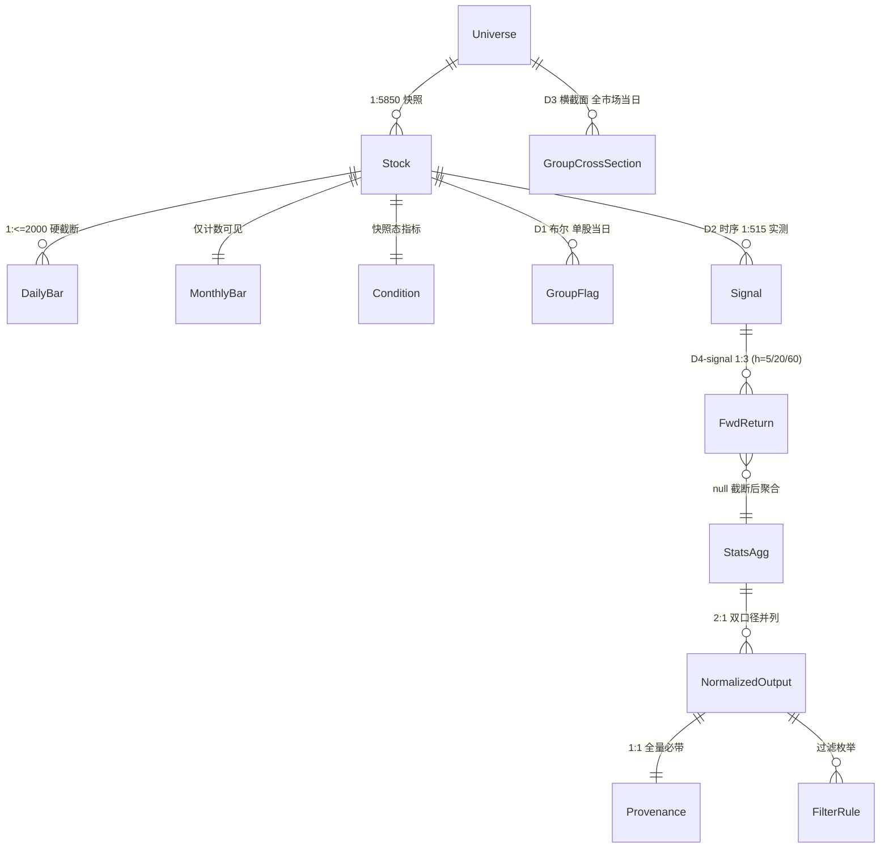

# 内网既有「A股条件分析终端」(:8094) 数据口径规格 · Phase 2

> 文档类型：**数据口径规格（Data Contract / Metric Spec）**，非代码、非库表设计、非回测报告
> 编制：`data-engineer`（储海量，数据建模工程师） · 团队 `terminal-8094-review` · 阶段 Phase 2
> 版本：**v1.1 定稿**（按主理人裁决回填 R1–R4：G1 三维度陷阱、两条事实更正、`sample_n` 显式标注；R5 为与验收组协同的规格补漏，非新裁决。修订记录见 §0.4）
> 唯一写入文件：本文件 `docs/TERMINAL_8094_DATA_SPEC.md`（不与工程组代码文件冲突）
> 取证基线：`docs/TERMINAL_8094_EVIDENCE.md`、`docs/TERMINAL_8094_PHASE1.md`、`output/terminal_8094_probe.json`
> 取证计数：**32/32 PASS、反向对照 0/32，以 `output/terminal_8094_probe.json` 为唯一准据**；成员旧稿「27/27」作废（主理人裁决 4-3）
> 服务：`http://192.168.2.203:8094/`，A股条件分析终端 v0.1.0（**内网既有服务，非本平台部署**）
> 主题：回踩 10 周均线 · 月线 MACD 死叉 · 20 日振幅历史分位 · 分组 G1/G2/G3/G4/G5/G7/G11

---

## 0. 文档定位、时点与适用范围

### 0.1 时点（所有读数的统一标签）

| 项 | 值 | 来源 |
|---|---|---|
| 数据日 `latest_date` | **2026-11-17** | `meta_response.meta.latest_date` |
| 构建时刻 `built_at` | **2026-11-17 17:44:47** | `meta_response.meta.built_at` |
| 人工取证时刻 | 2026-11-17 17:55 (GMT+8) | `TERMINAL_8094_EVIDENCE.md` 页首 |
| 机读取证 `probe_time` | 2026-11-17T18:20:13+08:00 | `terminal_8094_probe.json` |
| 声明 universe 起点 | 2015-06-01 | `meta.universe_start` |
| 单股日线实际首根 | 2018-08-16 | `fwd_recompute.daily_first` |

四者属**同一份离线快照**。本文所有读数一律标注「**来源 :8094 + 时点 2026-11-17**」；需要精确到构建批次时附 `built_at=2026-11-17 17:44:47`。§1 口径表「来源时点」列统一写 `2026-11-17`，其含义即本表全量定义，不再逐行重复。

### 0.2 适用范围与铁律

- 本文只描述**上游既有口径的观测事实、可复算性、缺口与规整层应输出的规范化契约**；不定义上游应改成什么、不新增指标、不补历史、不做回测。
- 上游 **200 响应 `schema: {}` 共 8 处**（`empty_response_schemas=8`），无版本前缀、无指标指纹、无字段说明 → 本文口径表中「已披露否」几乎全为「否」，这是**结构性事实**，不是逐条猜测。
- 规整层为**旁路纯函数**（上游 JSON → 规范化对象 + 指纹 + 免责），不落库、不建索引、不写上游。
- 证据优先级：当 `EVIDENCE.md` 阶段性旧表述与 `PHASE1.md` 主理人裁决冲突时，**以裁决 4 与 `terminal_8094_probe.json` 机读数据为准**（典型即 F5，见 §2.4）。

### 0.3 三层建模视角在本轮的落地方式

| 层 | 本轮产物 | 位置 |
|---|---|---|
| 概念模型 | 实体清单、关系基数、ER 图 | 附录 A |
| 逻辑模型 | 逐字段口径表（定义/计算式/约束）、`stats_scope` 规范化对象 schema、`payload_fingerprint` 规范化 payload schema | §1、§3、§4 |
| 物理模型 / 索引 / 迁移 | **本轮不适用**（无上游 schema、无写权限、不改存储），仅给出「不适用声明 + 未来演进约束」，不编造 DDL | 附录 A.3–A.5 |
| AI 场景存储 | **不适用**（无向量/会话/Embedding 需求） | 附录 A.6 |
| 安全与合规 | §7 | §7、附录 A.7 |

### 0.4 定稿修订记录（v1.1：R1–R4 为主理人裁决回填，R5 为协同补漏非裁决）

| # | 回填项 | 裁决内容 | 落点 |
|---|---|---|---|
| R1 | **G1 三维度陷阱（本轮最重要纠正）** | `G1` 在 `/api/stock` 的 `groups` 里是「该股当日是否命中 G1」的**布尔标识**；`/api/signals?group=G1` 的 `total=515` 是**单股历史时序事件数**；`/api/stats` 的 `G1=576` 是**全市场当日横截面命中只数**。三者维度不同（布尔 / 时序 / 横截面），**绝不可相等判定或互相替代** | §1.1 维度列、§1.2 A7、§1.4、附录 A.1 |
| R2 | **F5 事实更正** | F5 **不是「不可复算」**：`fwd_h = close[t+h]/open[t+1]−1` 已全样本反推验证（5/20/60 三周期 n=413/412/407，T+1 开盘口径 max_abs_err=4.996e-05，收盘到收盘口径 mean_abs_err≈0.007），误差来自 4 位小数舍入。真实缺口是「契约未披露口径」+「单股日线截断 2000 根、首根 2018-08-16 与 universe_start 2015-06-01 不符」。改造建议是**补披露，不是标 UNVERIFIABLE** | §2.2–§2.4（原文已按此定性，此处显式锚定裁决）、附录 B ① |
| R3 | **上游取证计数更正** | 已从 27/27 更新为 **32/32**（反向对照 0/32），以 `output/terminal_8094_probe.json` 为准；成员文本中的「27/27」为旧稿，一律作废 | 文档头部、§6 |
| R4 | **F4 `sample_n` 显式标注** | `limit=60` 默认窗口 → `sample_n=60`；`limit=600` 全样本窗口 → `sample_n=515`；`agg.n` 随周期递减 59/58/53 源于 `null` 截断，属「有条件存活样本」，`truncation_rule` 需枚举化 | §3.1、§2.5 |
| R5 | **规范化 payload 维度字段补齐 + 确定性细则**（按 `qa-engineer` 验收器回执协同补漏，非新裁决） | ① §1.4.3 已声明「三维度字段均入 payload」但 §4.1 清单遗漏 → 补 `group_hit_flag` / `signal_event_total` / `cross_section_hit_count` + 各自 `dimension`；② `sample_n` 与 `signal_total` 须为**两个独立键**（数值可同为 515、维度不同，禁合并）；③ `stats_scope[]` 按 `scope_id` 固定顺序；④ `dimension` 不得归一为 null；⑤ 新增反向判据（改 caveat / dimension / degraded 后指纹必须不等），防「payload_fingerprint 也是常量」的恒真实现 | §4.1、§4.4 |

---

## 1. 口径清单（逻辑模型 · 逐字段）

### 1.1 口径总表

> 「计算式」列中标注 **〔推断〕** 者为基于响应样本与主题文案的合理推断，**上游未披露**，不得当作已确认实现；标注 **〔反推确证〕** 者为 §2 实证结论。
> 「可复算否」判定前提：仅凭上游只读 GET 已暴露的数据 + 已披露的计算式；"部分"= 能算同量纲近似值但缺关键规则。

**统计维度图例（本轮补列，v1.1）** —— 维度 = 观测粒度（沿哪条轴聚合），是判定两个数值能否相等/互替的**第一前提**，优先于名称与数值：

| 代号 | 维度 | 粒度 | 聚合轴 | 典型值域 |
|---|---|---|---|---|
| `D1` | **单股当日布尔标识** | `(code, trade_date)` | 无（0/1 状态） | `true/false` |
| `D2` | **单股历史时序事件数** | `(code, group)` | 沿**时间轴**累加 | 整数计数（如 515） |
| `D3` | **全市场当日横截面只数** | `(trade_date)` | 沿**标的轴**计数 | 整数计数（如 576 / 5850） |
| `D4` | **单股单时点标量**（无聚合，一行观测一个值） | `(code, trade_date)` 或 `(code, group, signal_date)` | 无 | 浮点（如 `dist` / `ma5w` / `fwd_h`） |
| `D5` | **口径聚合量** | `(code, group, scope_id, h)` | 沿时间轴按窗口聚合 | 比率 / 均值 / 计数 |
| `D6` | **全库快照元数据** | `(built_at)` | 全库存量计数 | 整数 |

> `D4` 统一涵盖「单股当日指标」（`amp` / `amp_pct` / `dist` / `ma5w` / `ma10w`）与「单股单信号前向收益」（`fwd_h`）：两者都是**单行观测上的标量、无聚合**，故归同一维度族；在需要区分时可加后缀 `D4-daily` / `D4-signal`。
> `D1 / D2 / D3` 三者互不等价、不可相等判定、不可互相替代 —— 见 §1.4。

| 字段名 | 统计维度 | 定义 | 计算式 | 已披露否 | 可复算否 | 来源时点 |
|---|---|---|---|---|---|---|
| `touch` | `D1` | 回踩 10 周均线，布尔 | 未披露〔推断〕：当日价格触及 10 周均线且未有效跌破；G7 定义为「回踩 + 非死叉 + 窄幅」，`touch=true` | **否** | **否**（缺 `ma10w` 序列与阈值） | 2026-11-17 |
| `dead` | `D1` | 月线 MACD 死叉，布尔 | 未披露〔推断〕：月线 DIF 下穿 DEA；G7 样例 `dead=false`（非死叉） | **否** | **否**（月线序列未开放，仅 `n_monthly=5850` 计数） | 2026-11-17；是否含未完成月【待确认】 |
| `amp` | `D4-daily` | 20 日振幅（原始幅度） | 未披露〔推断〕：`(max(high[t-19..t]) − min(low[t-19..t])) / ref`；**三份基线中从未出现裸 `amp` 字段**，仅见 `amp_pct`【待确认】 | **否** | **否** | 2026-11-17 |
| `amp_pct` | `D4-daily` | 20 日振幅的历史分位（0~1） | 未披露（分位回看窗口、分母、是否滚动均未知）；实测值 0.001 / 0.019 / 0.213 / 0.282 / 0.015 / 0.002 | **否** | **否** | 2026-11-17 |
| `narrow` / `wide` | `D1`；其汇总量 `narrow_n` 为 `D3` | 窄幅 / 宽幅标记，由 `amp_pct` 阈值切分 | 未披露（阈值未知）；`narrow_n=1106`（`D3`）；**`wide` 未在响应出现，为对偶推断**【待确认】 | **否** | **否** | 2026-11-17 |
| `dist` | `D4-daily` | 收盘价相对均线的偏离度 | 未披露〔推断〕：`(close − ma) / ma`；实测 −0.1685 / 0.0373 / 0.0006 / −0.0043。**响应只暴露 `ma5w` 而非 `ma10w`**，故无法用响应字段直接复算 | **否** | **否** | 2026-11-17 |
| `ma10w` | `D4-daily` | 10 周均线（主题声明的判定基准） | 未披露〔推断〕：周线重采样后 10 周收盘均值。**三份基线中该字段从未作为响应字段出现**【待确认】 | **否** | **否**（且受 2000 根硬截断限制） | 2026-11-17 |
| `ma5w` | `D4-daily` | 5 周均线（响应实际暴露字段） | 未披露；实测 0.38 / 31.038 / 1.58 / 14.38 | **否** | **否** | 2026-11-17 |
| `fwd5` / `fwd20` / `fwd60` | `D4-signal` | 信号日 t 后 h 个交易日的前向收益 | **〔反推确证〕** `fwd_h = close[t+h] / open[t+1] − 1`（信号次日开盘买入，第 t+h 日收盘） | **否**（`fwd_disclosed_in_contract=false`，OpenAPI 无字段说明）→ **这正是真实缺口** | **是**（MAE 2.335e-05 ~ 2.510e-05，max 4.996e-05） | 2026-11-17 |
| `agg.win` | `D5` | 胜率，某周期 `fwd_h > 0` 的占比〔推断〕 | 未披露（「胜」是否含 `=0`、是否剔除 null 未披露）；默认口径 0.661 / 0.707 / **0.906**，全样本 0.518 / 0.474 / **0.596** | **否** | 部分 | 2026-11-17 |
| `agg.avg` | `D5` | 平均前向收益 `mean(fwd_h)` over 有效样本〔推断〕 | 未披露（是否算术平均、是否含 null）；默认 0.0089 / 0.0815 / 0.2132，全样本 0.0017 / 0.0188 / 0.0551 | **否** | 部分 | 2026-11-17 |
| `agg.n` | `D5` | 参与该周期聚合的有效信号数（`fwd_h` 非 null） | 剔除条件未披露 → 需 `truncation_rule`；默认 **59 / 58 / 53**，全样本 **514 / 513 / 508**，随 h 递减 | **否**（截断规则未披露） | **否** | 2026-11-17 |
| `total` | **同名异义且异维度**：`stats.total` = `D3`；`signals.total` = `D2` | 见 §1.2 A1、§1.4 | `stats.total=5850`（`D3` 全市场当日横截面**标的只数**）；`signals.total=515`（`D2` 单股某分组**历史时序事件数**） | **否** | 前者可与 `meta.n_stocks` 交叉核对（是，同为 `D3`/`D6`）；后者否 | 2026-11-17 |
| `G1..G11` | **三处同名、三种维度**：`groups.G*` = `D1`；`/api/signals?group=G*` 的 `total` = `D2`；`/api/stats` 的 `G*` = `D3` | 见 §1.4（本轮核心纠正） | 分组定义未披露；`/api/stats` 实测仅 7 个：`G1=576, G2=464, G3=112, G4=160, G5=169, G7=26, G11=115`（均 `D3`）；`G6/G8/G9/G10` 未出现在响应【待确认】 | **否** | **否** | 2026-11-17 |
| `dead_n` / `touch_n` / `narrow_n` | **`D3` 全市场当日横截面命中只数** | 全市场单条件命中计数（沿标的轴），**不是**单股历史时序 | **4668 / 576 / 1106**；条件计算式未披露 | **否** | **否** | 2026-11-17 |
| `n_stocks` / `n_days` / `n_monthly` / `name_hit` | `D6` | 全库快照元数据 | 5850 / 11647813 / 5850 / 5830；均为存量计数，非派生指标 | 部分（有值无定义） | 是（数值可交叉核对） | 2026-11-17 |

### 1.2 同名异义与口径不对齐登记（**高危，验收必须区分**）

| # | 现象 | 实测 | 若混淆的后果 | 规整层处置 |
|---|---|---|---|---|
| A1 | `total` **同名异义且异维度** | `stats.total = 5850`（`D3` 全市场当日横截面标的只数，= `meta.n_stocks`）；`signals.total = 515`（`D2` 单股历史时序事件数，`sz300398?group=G1`；`limit=60` 时 `items=60`、`limit=600` 时 `items=515`） | 断言「两处 total 应相等」→ 恒假 FAIL；或把 515（`D2`）当全市场（`D3`）规模 → 分母全错 | 规范化对象内改名为 `universe_size` / `signal_total`，禁止裸 `total` 透传，并强制带 `dimension` 枚举（§1.4.3） |
| A2 | 两套 `n` 不同对象 | **反推配对 n = 413 / 412 / 407**（本次实证中能同时取到 `open[t+1]` 与 `close[t+h]` 的信号数）；**聚合口径 `agg.n` = 59 / 58 / 53**（默认）/ 514 / 513 / 508（全样本） | 互相校验 → 恒假 FAIL；把 413 写进 `caveat` 文案 → 口径污染 | 分别命名 `recompute_pair_n` 与 `sample_n`，永不做等式断言 |
| A3 | 主题 10 周线 vs 字段 5 周线 | 主题「回踩 10 周均线」、`touch_n=576`；响应字段只有 `ma5w`（无 `ma10w`） | 用 `ma5w` 复算 `dist` / `touch` → 系统性偏差被当成「算错」 | 标【待确认】，规整层不据此复算，仅透传 + 标注 |
| A4 | `/api/stats` 的 G 横截面计数之和 ≠ 全市场 | 576+464+112+160+169+26+115 = **1622** ≠ 5850（三者均 `D3`，同维度可比） | 把分组当全体的完备划分（partition）→ 覆盖率、命中率全错 | 显式声明「`stats.G*` 为各主题条件当日横截面命中只数（`D3`），非完备划分」；**不可与 `D1` 布尔或 `D2` 时序混加** |
| A5 | `G1(576)` 与 `touch_n(576)` 数值相等 | 两处独立字段恰好同为 576 | 直接断言「G1 即 touch 集合」 → 无证据的结论 | 登记为观测巧合，标【待确认】 |
| A6 | `bias6=0.0` / `cci14=0.0` 是**伪零哨兵** | 与 `adx/pdi/mdi=null` 同时出现（见 §5.3） | 只按 `is None` 过滤 → 漏掉 `cci14=0.0` 的 `sz000851`；把 0 当真实指标值参与排序 | 过滤判定式须含「伪零簇」识别 |
| **A7** | **`G1`（及 G2..G11）三处同名、三种统计维度**（主理人裁决 R1，本轮核心纠正） | `/api/stock` 的 `groups.G1` = `D1` 单股当日布尔；`/api/signals?group=G1` 的 `total=515` = `D2` 单股历史时序事件数；`/api/stats` 的 `G1=576` = `D3` 全市场当日横截面命中只数 | 三者**绝不可相等判定或互相替代**：把 576 当单股事件数、把 515 当全市场规模、用布尔标识替代计数 → 恒假 FAIL / 覆盖率分母全错 | 见 §1.4：三处分别改名 `group_hit_flag` / `signal_event_total` / `cross_section_hit_count`，并强制标注 `dimension` 枚举 |

### 1.3 口径披露状态汇总

| 类别 | 字段 | 结论 |
|---|---|---|
| 算法可独立复算、但**契约未披露** | `fwd5/fwd20/fwd60` | 唯一「可复算=是」。缺口是**披露**，不是算法（§2） |
| 数值可交叉核对 | `stats.total`、`n_stocks`、`name_hit` 派生缺口 20 | 仅一致性核对，不产生新口径 |
| 未披露且不可复算 | `touch/dead/amp/amp_pct/narrow/wide/dist/ma10w/ma5w`、`agg.win/avg/n`、`G1..G11`、`dead_n/touch_n/narrow_n` | 规整层只做**透传 + 标注 + 免责**，禁止反推填充 |

### 1.4 `G1..G11` 三维度陷阱（主理人裁决 R1 · 本轮核心纠正）

> **裁决原文**：`G1` 在 `/api/stock` 的 `groups` 里是「该股当日是否命中 G1」的布尔标识；`/api/signals?group=G1` 的 `total=515` 是**单股历史时序事件数**；`/api/stats` 的 `G1=576` 是**全市场当日横截面命中只数**。三者维度不同（布尔 / 时序 / 横截面），**绝不可相等判定或互相替代**。

#### 1.4.1 三处同名字段的维度对照

| 出现处 | 字段 | 维度代号 | 语义 | 粒度 | 聚合轴 | 实测值 | 值域 |
|---|---|---|---|---|---|---|---|
| `GET /api/stock/{code}` | `groups.G1` | **`D1`** | **该股当日是否命中 G1**（布尔标识） | `(code, trade_date)` | 无（0/1 状态） | `true` / `false` | bool |
| `GET /api/signals/{code}?group=G1` | `total` | **`D2`** | **单股历史时序事件数**（该股在 G1 条件下历史触发的信号次数） | `(code, group)` | 沿**时间轴**累加 | **515**（`sz300398` G1） | int ≥ 0 |
| `GET /api/stats` | `G1` | **`D3`** | **全市场当日横截面命中只数**（当日全市场满足 G1 的标的数） | `(trade_date)` | 沿**标的轴**计数 | **576** | int ≥ 0 |

> 补充：`group=G1` 在 `/api/signals` 里还是**查询筛选参数**（决定取哪一组信号序列），它本身不是数值口径；其返回的 `total` 才是 `D2`。三者中只有 `D3` 与 `dead_n/touch_n/narrow_n`（4668 / 576 / 1106）同维度，可同表陈列但仍不可互相推定。

#### 1.4.2 为什么「维度不同」必须优先于「名称相同」

| 误用 | 具体错误 | 后果 |
|---|---|---|
| 把 `G1=576` 当单股事件数 | 用 576 去除以/替代 515 | 断言 `576 == 515` → **恒假 FAIL**；或把 61 的差当成数据不一致 |
| 把 `total=515` 当全市场规模 | 用 515 当覆盖率/命中率分母 | 分母错 → 全市场统计口径全错（正确分母是 `D3` 的 5850） |
| 用 `groups.G1=true` 替代计数 | 布尔参与求和或做等式 | 类型/量纲不匹配，`true` 既不是 576 也不是 515 |
| 把 `G1=576` 与 `touch_n=576` 相等当证据 | 两者同为 `D3`，数值巧合 | 仍不能据此断定「G1 即 touch 集合」（§1.2 A5 维持【待确认】） |
| 把 `D2` 沿时间轴累加的量与 `D3` 沿标的轴计数的量放进同一 `stats_scope` 做相等判定 | 跨维度比较 | 违反「不对上游数值做相等判定」（§3.4），且破坏双通道验收 |

**建模判据**：两个数值可相等判定/互替的必要条件是 **维度代号相同、粒度相同、聚合轴相同、来源端点相同、时点相同** 五者齐备。`G1` 三处仅「名称」相同，其余全部不同 → **无条件禁止相等判定**。

#### 1.4.3 规整层规范化处置（供实现与验收）

| 原字段 | 规范化字段 | 类型 | `dimension` 枚举 | 约束 |
|---|---|---|---|---|
| `groups.G1` | `group_hit_flag` | bool | `per_stock_daily_flag`(`D1`) | 保留 `group_id`；禁止转为数值计数 |
| `signals.total` | `signal_event_total` | int | `per_stock_timeseries_count`(`D2`) | 恒绑定 `(code, group, as_of)`；**改名以避开 `total` 同名异义**（§1.2 A1） |
| `stats.G1` / `dead_n` / `touch_n` / `narrow_n` | `cross_section_hit_count` | int | `market_cross_section_count`(`D3`) | 恒绑定 `as_of`；与 `universe_size=5850` 同为 `D3`/`D6`，是唯一可做一致性核对的一对 |

- 三者**必须各自带 `dimension` 枚举字段**，禁止裸 `G1` / `total` 透传。
- 三者均纳入 `payload_fingerprint` 规范化 payload（§4.1），但**不进入任何跨维度相等断言**。
- `stats_scope` 中 `sample_n`（默认 60 / 全样本 515）为 `D5` 口径聚合量，`signal_total=515` 为 `D2` —— 二者数值可相同但**维度不同**，见 §3.1 说明，同样禁止相等判定。

---

## 2. F5 前向收益口径反推（本轮最关键实证）

### 2.1 反推方法：多候选口径逐一比对平均绝对误差

**数据源（均只读 GET）**

- `GET /api/stock/sz300398?days=999999` → 日线序列，**硬截断 2000 根**，`daily_first=2018-08-16`、`daily_last=2026-11-17`，含 `open` / `close`。
- `GET /api/signals/sz300398?group=G1&limit=600` → `items`（信号日 t 与接口给出的 `fwd5/fwd20/fwd60` 实测值），`total=515`。

**候选口径集**（分子卖出价 × 分母买入价的笛卡尔组合；仅 C1、C2 有逐周期实测误差留档，其余为方法描述，不编造数值）：

| 编号 | 候选式 | 含义 |
|---|---|---|
| C1 | `close[t+h] / close[t] − 1` | 信号日收盘 → 收盘（EVIDENCE §5 初稿自算所用） |
| **C2** | **`close[t+h] / open[t+1] − 1`** | **信号次日开盘买入 → 第 t+h 日收盘** |
| C3 | `close[t+h] / close[t+1] − 1` | T+1 收盘买入 |
| C4 | `open[t+h] / open[t+1] − 1` | 开盘 → 开盘 |
| C5 | `close[t+h] / open[t] − 1` | 信号日开盘买入 |

**比对步骤**

1. 对每个信号日 t、每个周期 h ∈ {5, 20, 60}，从日线取 `open[t+1]`、`close[t+h]` 及各候选所需价格，算出候选值 `ĉ`。
2. 与接口 `fwd_h` 求绝对误差 `|ĉ − fwd_h|`，逐周期统计 **MAE（mean_abs_err）** 与 **max_abs_err**。
3. 可配对样本数 n 逐周期递减，因 `t+h` 越界、`t+1` 越界或价格缺失 → 该样本剔除；h 越大可配对越少。
4. 判据：取 MAE 最小、且 max_abs_err 落在「4 位小数舍入误差理论界」内的候选为真实口径。

### 2.2 结论与实测证据表

> **结论：`fwd_h = close[t+h] / open[t+1] − 1`（信号次日开盘买入，第 t+h 日收盘卖出）。**
> 与 `PHASE1.md` 裁决 4-1、`EVIDENCE.md` §9「T 收盘信号 / T+1 开盘撮合」基线一致。

| h | 可配对 n (`recompute_pair_n`) | **C2（T+1 开盘）mean_abs_err** | **C2 max_abs_err** | C1（收盘→收盘）mean_abs_err |
|---|---|---|---|---|
| 5 | **413** | 2.335e-05 | 4.952e-05 | 0.007021 |
| 20 | **412** | 2.505e-05 | **4.996e-05** | 0.007093 |
| 60 | **407** | 2.510e-05 | 4.995e-05 | 0.007317 |
| 全局 | — | ≈ 2.5e-05 | **4.996e-05**（`probe.json` F5 断言 `max_abs_err=0.00004996, ns=[413,412,407]`） | **≈ 0.007**（最小 0.007021，F5b 断言） |

机读锚点：`fwd_recompute.verified_formula`、`fwd_recompute.per_horizon`、`checks[16]`（F5）、`checks[17]`（F5b）。

### 2.3 误差归因：**4 位小数舍入，不是算法错误**

- 接口 `fwd_h` 输出为 **4 位小数**（如 −0.0448、0.0957、−0.0566、−0.1686），量化步长 `1e-4`，四舍五入的**最大绝对误差 = 0.5 × 10⁻⁴ = 5.0e-05**。
- 实测 C2 全局 `max_abs_err = 4.996e-05 < 5.0e-05`，且逐周期 MAE `2.335e-05 / 2.505e-05 / 2.510e-05 ≈ 2.5e-05`，恰为**半个舍入步长**，符合舍入误差在 `[0, 5e-5]` 上均匀分布的理论均值。
- C1 的 MAE ≈ **0.007**（约 0.7 个百分点，与 EVIDENCE §5 初稿「相差 0.7~1.2 个百分点」吻合），比舍入噪声大 **约 280 倍 / 两个数量级以上**，且是**系统性单向偏差**（分母由 `close[t]` 换成 `open[t+1]`，含隔夜跳空），不是随机噪声。
- **反证**：若上游算法有缺陷，残差不会整齐地卡在 `5e-5` 界内、均值恰为半步长、且三个周期高度一致。故残差是**量化噪声**，算法自洽。

> 明确结论：**误差来自 4 位小数舍入，不是算法错误。**

### 2.4 真实缺口定性：**契约未披露**，而非「算错」或「不可复算」

| 误判 | 为何不成立 | 正确处置 |
|---|---|---|
| 「F5 前向收益无法用同接口日线复算」（`EVIDENCE.md` §5 标题，阶段性旧表述） | 换用 C2 口径后三周期 MAE ≈ 2.5e-05，全样本可独立复算 | **不标 UNVERIFIABLE**；以裁决 4-1 为准 |
| 「上游算错了，要改算法」 | 见 §2.3，残差为舍入噪声 | **不改上游算法、不改上游数据** |
| 「算法自洽就万事大吉，无需改造」 | `fwd_disclosed_in_contract = false`；200 响应 `schema:{}`（8 处）、无字段说明、无买入时点说明、无复权/除权说明 | 改造动作 = **补披露** |

> **按主理人裁决 R2 定稿锚定**：F5 **不是「不可复算」**。`fwd_h = close[t+h]/open[t+1]−1` 已全样本反推验证（三周期 n=413/412/407，T+1 开盘口径 max_abs_err=4.996e-05，收盘到收盘口径 mean_abs_err≈0.007），误差来自 4 位小数舍入。真实缺口 = 「契约未披露口径」+「单股日线截断 2000 根、首根 2018-08-16 与 `universe_start=2015-06-01` 不符」。**改造建议 = 补披露，不是标 UNVERIFIABLE，也不是改算法**（§0.4 R2）。

`补披露` 的最低内容（写入规整层 `provenance` / 口径说明，不改上游）：公式 `fwd_h = close[t+h]/open[t+1]−1`、买入时点 T+1 开盘、卖出时点 t+h 收盘、输出精度 4 位小数、可复算范围边界（单股日线 2000 根，`2018-08-16` 起）、复权假设【待确认】、`truncation_rule`。

**附带缺口（属可复算范围边界，非算法错误）**：单股日线硬截断 **2000 根**（首根 `2018-08-16`），而 `meta.universe_start = 2015-06-01`；`days=999999` 仍只返回 2000 根（449,253 B）。故 **2015-06-01 ~ 2018-08-15 区间无法经 `/api/stock` 复算**。两者是全库声明起点与单股接口窗口的不一致，不编造为「历史数据缺失」【待确认】。

### 2.5 `agg.n` 随周期递减：`null` 截断 → 有条件存活样本，须披露 `truncation_rule`

**先区分两套 n（见 §1.2 A2）**：`413/412/407` 是本次反推的**配对样本数**；`59/58/53`（默认 `limit=60`）与 `514/513/508`（全样本 `limit=600`）是 signals 响应里 `agg` 的**聚合有效样本数**。二者不是同一计数对象，**禁止互相校验**。

**机制**：`fwd_h` 需要 `close[t+h]`；越靠近 `latest_date=2026-11-17` 的信号，`t+h` 越界 → `fwd_h = null` → 从该周期 `agg.n` 剔除。h 越大，被剔除的尾部信号越多 → n 单调递减。

**交叉验证（强证据）**：以各自窗口的 `items` 为基数，缺失数在两个完全不同的窗口里完全一致 ——

| 周期 | 默认窗口 `items=60` 的缺失数 | 全样本 `items=515` 的缺失数 | 一致性 |
|---|---|---|---|
| `fwd5` (n=59 / 514) | 60 − 59 = **1** | 515 − 514 = **1** | ✓ |
| `fwd20` (n=58 / 513) | 60 − 58 = **2** | 515 − 513 = **2** | ✓ |
| `fwd60` (n=53 / 508) | 60 − 53 = **7** | 515 − 508 = **7** | ✓ |

即「最近 1 条缺 `fwd5`、最近 2 条缺 `fwd20`、最近 7 条缺 `fwd60`」，两窗口同值 → 截断是**纯时间轴尾部**、与样本窗口大小无关，且与「null 丢弃」机制自洽。

**统计后果（必须写进免责）**：能进入 `fwd60` 统计的信号必须「发生得足够早」，样本被**未来数据可用性反向选择**，天然剔除近期信号。这是 **有条件存活样本（conditional survival sample）**，存在选择偏差：

- `fwd60` 胜率（默认 **0.906** / 全样本 **0.596**）**不可**与 `fwd5` 横比，也**不可**解释为「持有越久策略越有效」；
- 默认口径 0.906 与全样本 0.596 差 **0.3100**（`checks[14]`: `default=0.906 full=0.596 gap=0.3100`），界面未标注「最近 60 次」口径，属 F4 展示口径分裂。

**`truncation_rule` 必须至少披露**：① 剔除条件（`fwd_h is null`）；② 剔除方向（时间轴尾部）；③ 是否按周期独立剔除；④ 最大可观测 h（60）；⑤ 被剔除尾部条数（1 / 2 / 7）。当前上游**未披露**，故规整层在 `stats_scope.truncation_rule` 中标注 `disclosed_by_upstream=false` 并置 `caveat.conditional_survival_sample`。

---

## 3. F4 双口径建模：`stats_scope` 规范化对象

### 3.1 对象 schema（**双口径 = 两个并列实例**，不做合并、不做数值相等判定）

| 字段路径 | 类型 | 必填 | 默认 | 枚举 / 约束 | 说明 |
|---|---|---|---|---|---|
| `stats_scope.schema_version` | string | 是 | `"1.0"` | 语义化版本 | 契约演进锚点，见附录 A.5 |
| `stats_scope[].scope_id` | enum | 是 | — | `default` \| `full` | 口径唯一标识，入指纹 |
| `stats_scope[].sample_n` | int | 是 | — | `≥ 0` | **按裁决 R4 显式标注**：`scope_id=default`（`limit=60` 默认窗口）→ **`sample_n=60`**；`scope_id=full`（`limit=600` 全样本窗口）→ **`sample_n=515`**。取值为该口径 `items` 条数（`D5`），**不等于 `agg.n`** |
| `stats_scope[].window` | enum | 是 | — | `recent_60` \| `full_history` | 与 `scope_id` 绑定：`default→recent_60`（60）、`full→full_history`（515） |
| `stats_scope[].limit` | int | 是 | — | `60` \| `600` | 上游透传参数：`default→60`、`full→600`；须 ≤ 规整层 `limit` 上界 |
| `stats_scope[].signal_total` | int | 是 | — | `≥ sample_n` | 上游 `signals.total`（本例 **515**，维度 `D2` 单股历史时序事件数）。**改名以避开 §1.2 A1 同名异义**；与 `sample_n=515` 数值虽同但**维度不同（`D2` vs `D5`），禁止相等判定** |
| `stats_scope[].horizons` | array\<int\> | 是 | `[5,20,60]` | 元素 ∈ {5,20,60} | 固定顺序，保证指纹确定 |
| `stats_scope[].truncation_rule.rule` | enum | 是 | `drop_if_fwd_null` | `drop_if_fwd_null` \| `undisclosed` | 当前上游未披露 → 规整层固定标注 `upstream` 未披露事实 |
| `stats_scope[].truncation_rule.direction` | enum | 是 | `tail` | `tail` \| `unknown` | §2.5 交叉验证结论 |
| `stats_scope[].truncation_rule.per_horizon` | bool | 是 | `true` | — | 是否按周期独立剔除 |
| `stats_scope[].truncation_rule.max_horizon` | int | 是 | `60` | — | — |
| `stats_scope[].truncation_rule.tail_dropped` | map\<h,int\> | 否 | `{5:1,20:2,60:7}` | — | 观测值，标注为「按快照推算」 |
| `stats_scope[].truncation_rule.disclosed_by_upstream` | bool | 是 | **`false`** | — | 恒 false 直至上游披露 |
| `stats_scope[].agg` | map\<h, {n:int, avg:number\|null, win:number\|null}\> | 是 | — | 数值范围 `[0,1]`（win）、avg 可负 | **原样透传上游 `agg`，不做相等判定、不重算、不修正**（§3.4） |
| `stats_scope[].caveat` | array\<enum\> | 是 | 见 §3.2 | 四项全含 | 顺序固定（字典序）以保证指纹确定 |
| `stats_scope[].strategy_verdict` | enum | 是 | **`not_approved`** | 仅 `not_approved` | 恒定，见 §3.3 |
| `stats_scope[].disclaimer` | object | 是 | — | `research_only=true`、命中「不构成投资建议」 | F8 全量覆盖，含错误/降级响应 |
| `stats_scope[].provenance.source` | string | 是 | `":8094"` | — | 来源标识 |
| `stats_scope[].provenance.as_of` | string | 是 | `"2026-11-17"` | ISO 日期 | 时点标签 |
| `stats_scope[].provenance.stale` | bool | 是 | `false` | — | 降级/缓存/样例时置 true + 「非实时·缓存/样例」文案 |

**3.1.1 双口径窗口与 `agg.n`（裁决 R4 定稿标注）**

| 口径实例 | `scope_id` | `limit` | `window` | **`sample_n`** | `signal_total` | `items` | `agg.n`（fwd5/20/60） | `agg.win`（fwd5/20/60） |
|---|---|---|---|---|---|---|---|---|
| 默认（前端展示） | `default` | **60** | `recent_60` | **60** | 515 | 60 | **59 / 58 / 53** | 0.661 / 0.707 / **0.906** |
| 全样本 | `full` | **600** | `full_history` | **515** | 515 | 515 | 514 / 513 / 508 | 0.518 / 0.474 / **0.596** |

- `agg.n` 随周期递减（默认 **59 / 58 / 53**）源于**未来数据不足时 `fwd_h = null` 被剔除**（尾部截断），并非「数据缺失」或「计算缺陷」。这使进入统计的信号被未来数据可用性反向选择 → **有条件存活样本（conditional survival sample）**，须写入 `caveat`。
- `truncation_rule` **必须枚举化**（子对象字段固定为 `rule` / `direction` / `per_horizon` / `max_horizon` / `disclosed_by_upstream` 五个必填 + `tail_dropped` 一个可选观测值，见上表 schema），禁止以自由文本描述；当前上游未披露 → `disclosed_by_upstream=false`。交叉验证与统计后果见 §2.5。（注意：此处是 `truncation_rule` 的**子字段**，与 §4.1 中 PM v1.2「五字段入指纹」所指的 `stats_scope` 五个口径字段是两回事，勿混。）
- `sample_n`（`D5`）与 `signal_total`（`D2`）在 `full` 口径同为 515，但**维度不同，禁止相等判定**（§1.4.2）。

### 3.2 `caveat` 枚举数组（**恒含四项，顺序固定**）

| 枚举值 | 中文常量文案 | 对应证据 |
|---|---|---|
| `no_cost_model` | 未计成本 | 响应无成本模型字段 |
| `no_oos` | 无样本外 | 响应无样本外拆分 |
| `no_multiple_testing_correction` | 无多重检验校正 | 响应无 BH-FDR / DSR / HAC |
| `conditional_survival_sample` | 有条件存活样本 | §2.5 `agg.n` 尾部截断 |

`rigor_keys_present = []`、`checks[15]` 实测 `response_keys=['agg','code','group','items','name','total']` → 无随机对照、无基准超额、无置信区间、无 `oos_use_count`、无预注册冻结。

> 四项枚举值**按主理人裁决 R4 定稿采用**：`no_cost_model` / `no_oos` / `no_multiple_testing_correction` / `conditional_survival_sample`，为封闭枚举（只增不改义，见附录 A.5），恒含四项、顺序固定（字典序）以保证指纹确定。

### 3.3 `strategy_verdict` 恒 `not_approved`

- 单值枚举，**恒为 `not_approved`**（按主理人裁决 R4 定稿），**不随 `agg.win` / `agg.avg` / `scope_id` / 上游数值变化**；即使默认口径 `fwd60` 胜率 0.906，仍为 `not_approved`。
- 依据：本平台 v1/v2 对同一主题的裁决为「**工程可复跑 / 策略级结论不放行**」，含 HAC t、BH-FDR、DSR、等价随机对照、预注册冻结与 `oos_use_count`；规整层**不做统计推断**，且无 8094 源码/写权限、不改上游数据。
- `strategy_verdict` 与 `disclaimer` 属全量响应必带字段，含错误体与降级体（PM v1.2 §5-2、附录 A）。
- 与 §3.4「不对上游胜率数值做相等判定」配套：`verdict` 是**恒定结论**，不参与任何数值比较，也不因双口径差异翻转。

### 3.4 **不对上游胜率数值做相等判定** —— 理由（写透）

> 规整层对 `agg.win` / `agg.avg` / `agg.n` 只做 **透传 + 标注 + 免责**，不写「期望值 = 0.906」这类断言。

1. **违铁律**：Phase 1 明文「**0 条判据断言『8094 返回结果变正确』**」。把上游数值固化为期望值，等价于断言「上游结果正确」，直接越界。规整层是旁路，不是上游校验器。
2. **会把私有实现固化进我方契约**：`agg.win` 是未披露口径的派生量（「胜」的定义、`truncation_rule`、复权、样本窗口全未披露）。锁定其数值 = 把我方契约绑定到上游私有实现，上游一改即误 FAIL —— 与 F1「PRESETS 映射漂移」同源（裁决 1 已据此否决 6 键冻结映射）。
3. **上游每日重建，数值天然漂移**：`built_at=2026-11-17 17:44:47`、`latest_date` 滚动，`agg.win` 随快照变化。离线 fixture（冻结快照）与在线 L2 的数值相等断言**不可同时成立**，会破坏「L1 离线 + L2 在线双通道」验收结构。
4. **与 F4 改造目标相反**：双口径并置的目的正是**暴露 0.906 vs 0.596 的口径差**（差 0.31）。断言数值相等会把差异抹平，反而掩盖缺陷。
5. **判据应落在结构而非数值**：正确可判定对象是 schema 完整性、枚举取值、`strategy_verdict`、`caveat`、`truncation_rule` 标注、`filtered_count`、指纹稳定性。数值只用于**展示与免责标注**，不用于**校验**。

---

## 4. 归一化指纹 `provenance.payload_fingerprint` 规范

**定义**：对「规范化 payload」做确定性哈希（建议 SHA-256 取前 16 位 hex），作为「同一 fixture 连续两次 → 可复跑」判据的**唯一有效断言对象**。

### 4.1 规范化 payload **必须包含**（内容相关，随条件/过滤/口径/降级态变化）

| 类别 | 字段 | 为何必须 |
|---|---|---|
| 溯源 | `source=":8094"`、`as_of="2026-11-17"`、`endpoint`、`schema_version` | 绑定快照时点，跨日不误判；来源可追 |
| 口径 | `scope_id`、`sample_n`、`window`、`limit`、`signal_total`、`horizons`、`truncation_rule`（全字段）、`caveat`、`strategy_verdict` | PM v1.2 §5-3「五字段入指纹」的下限；本规格固定为 `{scope_id, sample_n, window, limit, truncation_rule}` 五字段〔若原意含 `strategy_verdict` 以其为准【待确认】〕，并补齐口径其余结构字段 |
| 条件 | `applied_conds`、`conds_valid`、`error_code`（如 `INVALID_CONDS`） | F2 有效集回显 / 无效集 `ok=false`，条件变化必须进指纹 |
| 过滤 | `filter_rules`、`filtered_count`、`filter_mode` | F3 过滤结果变化必须进指纹 |
| 数据 | `data`（过滤后结果）、`data_kind` ∈ `live\|sample\|cache\|empty` | 核心内容；`data_kind` 防「降级响应被当作真实选股结果消费」 |
| 降级 | `degraded`、`provenance.stale`、`stale_reason`、`ok` | **必须纳入**，否则降级体与正常体指纹可能相同 → 静默错误复现 |
| 合规 | `disclaimer`（`research_only` + 文案） | F8 全量覆盖率的确定性锚点 |
| **统计维度（v1.1 新增，补齐 §1.4.3 的引用）** | `group_hit_flag` + `dimension`、`signal_event_total` + `dimension`、`cross_section_hit_count` + `dimension`；以及 `sample_n` 与 `signal_total` **两个独立键** | 三维度字段各自带 `dimension` 枚举入指纹，否则**维度漂移不可检出**（例如 `D2` 被误填成 `D3` 而数值不变）；`sample_n`（`D5`）与 `signal_total`（`D2`）在 `full` 口径数值同为 515 但维度不同，**禁止合并/去重**（§1.4.3、§3.1.1） |

### 4.2 规范化 payload **必须排除**

| 字段 | 排除理由 |
|---|---|
| `server_time` | 每次请求生成，非确定性。纳入 → 连续两次**恒不相等** → 恒假 FAIL，判据失效 |
| `request_id` | 每次请求唯一（幂等键关联），同上（PM v1.2 §5-6 已明确排除此二者） |
| `metric_fingerprint` | **继承恒量**（`e819989972c994d1`），与 payload 内容无关；纳入哈希无信息量，且会把恒真项带进判据（§4.3） |

排除须在**序列化之前**剥离，不是哈希后忽略。

### 4.3 **禁止用继承恒量 `metric_fingerprint` 做可复跑相等断言（恒真检查）**

- `metric_fingerprint` 来自既有 `envelope()`，按裁决 2 与架构附录 A，其值**恒为 `e819989972c994d1`**；无论 `data`、`applied_conds`、`filter_rules`、`degraded` 如何变化，它都不变。
- 因此「连续两次调用 `metric_fingerprint` 相等」是 **恒真命题（tautology）**：对任何内容漂移都返回 PASS，**检出能力为 0**，制造「可复跑已验证」的假安全感。
- **放大风险**：PM v1.2 §5-6 的判据原文为「排除 `{server_time, request_id}` 后 `data / metric_fingerprint / disclaimer / strategy_verdict` 逐字段差异数 = 0」。其中 `metric_fingerprint` 是常量，`disclaimer` 是常量文案，`strategy_verdict` 是常量枚举 → 三项近乎恒真，**唯一有鉴别力的只剩 `data`**，验收被严重稀释。若上游静默降级只改变口径标注而不改变 `data`，该判据仍会 PASS。
- **职责必须分离**：

| 对象 | 正确用途 | 断言形式 | 归属验收行 |
|---|---|---|---|
| `metric_fingerprint` | 证明规整层**复用了**既有 `envelope()`、未自建第二套信封（「复用事实」） | `== 'e819989972c994d1'`（常量等值） | 「**继承能力自检**」行，标注「零新增功能，仅验证复用生效」，不计 Must |
| `provenance.payload_fingerprint` | 证明**内容确定性 / 可复跑**（「内容确定性」） | 两次调用相等；内容变化则应不等 | L1 离线可复跑判据 |

  两者目的相反，**不可混用**，且 `metric_fingerprint` 必须从 payload 中排除。

### 4.4 规范化算法约定（保证确定性）

1. 所有对象键按字典序**递归排序**；紧凑 JSON、UTF-8、无多余空白。
2. 数组按业务键稳定排序：`data` 按 `code` 升序；`caveat` / `filter_rules` / `horizons` 按枚举字典序 / 数值升序；**`stats_scope[]` 按 `scope_id` 固定顺序（`default` 在前、`full` 在后）** —— 双口径若按上游返回顺序拼接，两次调用顺序可能不同 → 假差异（v1.1 补充）。
3. 数值统一序列化精度 —— **建议与上游 4 位小数对齐**，避免 `0.0089` 与 `0.008900000000000001` 造成假差异；`win` 固定 3 位、`avg` 固定 4 位。
4. `null` / `[]` / `None` **归一为单一表示**（建议统一 `[]`）：判据允许 `data ∈ {None, []}`，若不做归一，「语义等价但表示不同」会误 FAIL。**`dimension` 枚举恒为字符串、不得归一为 null**（缺维度即视为契约违规，而非等价表示）。
5. 排除字段在序列化前剥离（§4.2）。
6. 指纹 = `SHA-256(规范化字节)` 前 16 位 hex；值本身**不做相等于某个固定常量的断言**（那会重蹈 §4.3 覆辙），只做「同输入两次相等 / 不同输入不等」。
7. 本期按裁决 2「**不校验指纹具体取值或生成规范**」—— 本规范是给规整层的**实现约束**，验收表仍写「不校验具体取值」。
8. **反向判据（v1.1 补充，防恒真实现）**：至少验证「改 `caveat` 一项 → 指纹不等」「改 `dimension` 一项 → 指纹不等」「`degraded` 翻转 → 指纹不等」；否则无法排除「payload_fingerprint 本身也是常量」的恒真实现。仅「同输入连跑 N 次相等」不足以证明有鉴别力。

---

## 5. 缺失值与标的过滤规则

### 5.1 四类枚举判定式

> 判定式均基于**上游响应已暴露字段**；标注〔代理〕者为规整层推断，上游无显式字段【待确认】。

| 枚举 | 判定式（布尔） | 实测依据 |
|---|---|---|
| `metric_null` | `any(v is None for v in [adx, pdi, mdi, cci14, ...核心指标])` **OR** **伪零簇**：`adx is None AND pdi is None AND mdi is None AND bias6 == 0.0 AND cci14 in (None, 0.0)` | `sz000851`（adx/pdi/mdi=null, bias6=0.0, cci14=0.0）、`sz000627`（adx/pdi/mdi=null, bias6=0.0, cci14=null）；`null_metric_n=2 / 300` |
| `st` | `name` 匹配风险警示前缀：`re.match(r'^(S?\*?ST|SST|S\*ST)', name, re.I)` 或 `name.strip().upper().startswith(('ST','*ST','S*ST','SST'))` | `*ST高鸿`、`*ST天茂`、`*ST明德`、`ST凯利`；`st_n=10 / 300` |
| `unnamed` | `name is None OR name.strip() == ""` **OR** `code` 未命中名称映射（`name_hit=5830 < n_stocks=5850`，缺口 20 只） | `sz200570`（`name=""`，深市主板 B 股）；`g7_quality.st_or_unnamed=2 / 26` |
| `suspended` | 〔代理〕该标的**无 `latest_date` 当日日线**，或 `latest_bar_date < latest_date − tolerance`，或 `close` 长期恒定；**上游无显式停牌/退市字段**【待确认】 | `EVIDENCE.md` F3「无退市／长期停牌／ST 过滤」 |

**伪零识别（§1.2 A6，必须写进实现约束）**：`bias6=0.0` / `cci14=0.0` 在此上下文**不是「指标恰好为零」，而是「指标链未计算时的填充哨兵」** —— 判据是 ADX 族（`adx/pdi/mdi`）同时全为 null（ADX 需足够历史 bar），而 bias6 与 cci14 恰为 0.0。若过滤只按 `is None`，会漏掉 `cci14=0.0` 的 `sz000851`；若把 0 当真实值，会污染排序、分组与指纹。

### 5.2 默认排除 + 开关的产品裁决

来源：`PHASE1.md` 裁决 5「ST 处理：**默认排除 + 开关**（枚举 `metric_null / st / unnamed / suspended`），采纳 PM」；PM §8-②「ST『一律排除』vs『保留打标』：默认排除＋开关」。

| 项 | 裁决 |
|---|---|
| 默认 `filter_rules` | `[metric_null, st, unnamed, suspended]` |
| 默认 `filter_mode` | `exclude`（一律排除） |
| 开关 | `filter_mode ∈ {exclude, tag_only}`；`tag_only` 保留标的但打 `filter_flags`，**且** `strategy_verdict` 恒 `not_approved`、`disclaimer` 全量覆盖不变 |
| 作用范围 | **仅规整层输出**，不写回上游、不改上游选股结果、0 写入 |
| 输出字段 | `filtered_count` = 本次实际剔除条数；与 `filter_rules` 一并入 `payload_fingerprint`（§4.1） |
| 验收约束 | `filter_rules ⊆ {metric_null, st, unnamed, suspended}`；F3 判据：300 条 → null 数 = 0、ST 数 = 0、`filtered_count` = 剔除数 |

### 5.3 为什么 `*ST高鸿` (`sz000851`) **必须**被排除

实测快照（`preset_probe.default_first`、`pick_quality.null_examples[0]`、`conds_probe.invalid[*].first`）：

```
code=sz000851  name=*ST高鸿  market=深市主板  close=0.38
adx=null  pdi=null  mdi=null  bias6=0.0  cci14=0.0
cci_w=-30.5  cci_m=-130.3  cci_m_chg=15.71  ma5w=0.38
dist=-0.1685  amp_pct=0.001
```

| # | 理由 |
|---|---|
| 1 | 命中 `st`（`*ST` 退市风险警示前缀） |
| 2 | 命中 `metric_null`（ADX 族全 null + bias6/cci14 伪零哨兵），**整条指标链未计算** |
| 3 | `close=0.38`、`ma5w=0.38`（近乎相等）、`amp_pct=0.001`（近乎最小）→ 价格序列近乎恒定，符合长期停牌/退市整理特征，`suspended` 代理亦命中【待确认】 |
| 4 | **它是默认选股结果的首元素**（`default_first`）：F1 的 6 个 preset 与 F2 的全部无效 `conds` 都静默回退到它。即上游「无声降级」时用户看到的就是这只标的。规整层若不过滤，F2 的静默错误会以「看似正常的 *ST 低价股清单」形态原样透传，**等于把最危险的误导性结果交给使用者** |
| 5 | null / 伪零指标参与排序与比较（`EVIDENCE.md` F3），污染下游任何基于指标的排序、分组、指纹计算 |
| 6 | 合规：research-only 下输出具体 *ST 个股清单且无免责，放大 F8 风险 |

→ 它是 **F3（缺失值/风险标的）与 F2（静默降级）的双重必排样本**，也是验证过滤器有效性的首选反例。

---

## 6. 数据质量盘点表（全部为实测数字）

| 项 | 实测值 | 来源字段 / 断言 | 口径影响 |
|---|---|---|---|
| 全市场标的数（`D3`/`D6`） | **5,850** | `meta.n_stocks` = `stats.total` = 5850 | `stats.G*` 横截面计数之和 1622 ≠ 5850 → G 非完备划分（均 `D3`，同维度可比） |
| 日线总条数 | **11,647,813** | `meta.n_days` | 平均 ≈ **1,991 根/股**（11,647,813 / 5,850，**推算值**，假设均匀；与单股 2000 根截断量级一致） |
| 月线标的数 | **5,850** | `meta.n_monthly` | 仅计数，月线序列未开放 → `dead` 不可复算 |
| 名称命中 | **5,830** | `meta.name_hit` | **20 只名称缺失**（5,850 − 5,830）→ `unnamed` 枚举 |
| 数据日 | 2026-11-17 | `meta.latest_date` | 统一时点标签 |
| 构建时刻 | **2026-11-17 17:44:47** | `meta.built_at` | 与取证 17:55、probe 18:20:13+08:00 同一快照 |
| 声明 universe 起点 | 2015-06-01 | `meta.universe_start` | — |
| 单股日线实际首根 | **2018-08-16** | `fwd_recompute.daily_first` | 与 `universe_start` 差约 3 年 2.5 个月，该区间不可经接口复算 |
| 单股日线硬截断 | **2,000 根** | `fwd_recompute.daily_len`；`checks[18]` `len=2000` | `days=999999` 仍只返回 2000 根，响应 449,253 B |
| 单股日线末根 | 2026-11-17 | `fwd_recompute.daily_last` | 与 `latest_date` 一致 |
| G7 命中 | **26 只，含 2 只 ST 或无名** | `g7_quality.n=26, st_or_unnamed=2` | `sz300326 ST凯利`、`sz200570 name=""`（B 股） |
| pick 样本量 | **300 条** | `pick_quality.n` | — |
| pick 中 null 指标 | **2 只** | `null_metric_n=2` | `sz000851`、`sz000627` |
| pick 中 ST | **10 只** | `st_n=10` | — |
| 分组计数（`D3` 全市场当日横截面） | G1 576 / G2 464 / G3 112 / G4 160 / G5 169 / G7 26 / G11 115 | `stats` | 之和 1622；`G6/G8/G9/G10` 未出现【待确认】；**与单股历史时序事件数 515 不同维度，不可相等判定**（§1.4） |
| 单条件计数（`D3` 全市场当日横截面） | `dead_n=4668` / `touch_n=576` / `narrow_n=1106` | `stats` | `G1` 与 `touch_n` 同为 576 且**同为 `D3`**（巧合，是否同一集合仍【待确认】）；**不是**单股历史时序 |
| 单股历史时序事件数（`D2`） | 515（`sz300398?group=G1`） | `signals.total` | 与 `stats.G1=576`（`D3`）、`groups.G1`（`D1` 布尔）维度互异，绝不可互替（§1.4） |
| 取证计数（更正后） | **32/32 PASS、反向对照 0/32** | `terminal_8094_probe.json`（`passed=32, total=32`） | 旧稿「27/27」作废（裁决 4-3 / §0.4 R3） |
| 200 响应空 schema | **8 处** | `empty_response_schemas=8` | 全部口径「已披露否=否」的结构性根因 |
| 前向收益契约披露 | **false** | `fwd_disclosed_in_contract` | F5 真实缺口（§2.4），改造动作 = 补披露 |
| 上游延迟 P95（12 次采样） | meta 24ms / stats 9ms / pick 37ms / scan 15ms / stock?days=420 61ms / stock?days=999999 131ms / signals?limit=600 27ms | `PHASE1.md` 裁决 4-5 | 双口径需两次只读调用，并入 8s 端到端预算；`days` 边界拦截须在上游调用之前 |

---

## 7. 前视与合规

### 7.1 本轮规整层的三条不做

| 不做 | 依据 |
|---|---|
| **不改上游数据** | 无 8094 源码（HTTP 未暴露）、无服务端写权限；改造落点只能是本平台侧规整层 + 验收材料（`EVIDENCE.md` §0/§10、裁决 6） |
| **不补历史** | 2000 根硬截断与 `universe_start` 不一致是上游事实；补历史既越只读 GET 边界，又会引入前视偏差与复权不一致，反而制造新的口径污染 |
| **不做回测** | 超出「验证改造点」范围，触发范围膨胀（裁决 7 否决升级为完整研究引擎）；本文只描述口径与契约 |

### 7.2 前视（look-ahead）边界

- `fwd_h` 天然使用 `t+h` **未来数据**，是**历史回看统计量**，**绝不可**作为选股特征、信号输入或实时评分依据。
- `agg.win` / `agg.avg` 是历史命中统计，`EVIDENCE.md` F4 明确响应「无随机对照、无样本外拆分、无基准超额、无成本模型、无多重检验校正、无置信区间」；不构成未来收益预测。
- 规整层须在 `caveat`（§3.2）与 `disclaimer` 显式标注「历史回看 · 样本有限 · 不代表可复制的胜率」，且 `strategy_verdict` 恒 `not_approved`。
- `dead`（月线死叉）若使用**未完成月**（`latest_date=2026-11-17`，2026-11 月线未收），则 `dead_n=4668` 含未定稿状态，亦属潜在前视【待确认】。

### 7.3 时点标注与降级

- 所有读数标「**来源 :8094 + 时点 2026-11-17**」；需精确批次时附 `built_at=2026-11-17 17:44:47`。
- 降级 / 缓存 / 样例响应额外标「**非实时·缓存/样例**」+ `degraded=true` + `provenance.stale=true` + `data_kind ∈ {sample,cache,empty}`；硬约束「**降级响应不得以真实选股结果形态被消费**」「半包次数 = 0」（架构附录 A）。

### 7.4 research-only

- **不荐股、不给买卖点、不给目标价、不承诺收益、不代操作**。
- `disclaimer.research_only=true` 且命中「不构成投资建议」，覆盖**含错误体与降级体的全量输出**（完整率 100%），在 envelope 层统一注入（`PHASE1.md` §5-2、裁决：F8 前置于 F2）。
- **0 写入**：不 POST / DELETE、不触发任何上游任务；:8093 工作台保持只读 GET（其 `POST /api/tasks` 会触发 LLM 写操作）。
- 对照基线（**仅作对照，不假定上游一致**）：本平台「前复权 qfq 用于盯市 / 未复权 raw 用于涨跌停基准；T 收盘信号 / T+1 开盘撮合；盘中未收盘 bar 排除」。上游 `fwd_h` 与「T+1 开盘撮合」一致，但**复权 / 除权 / 未完成月线 / 未完成日 bar 是否同样处理均未披露**【待确认】，不得默认对齐。

---

## 8. 待确认（一律标注【待确认】，不编造）

| # | 待确认项 | 现状（证据基线中的事实） |
|---|---|---|
| 1 | 【待确认】上游日线是否**前复权 qfq**（还是 raw / 后复权）；`fwd_h` 是否基于复权序列 | 三份基线无任何复权说明；`fwd_disclosed_in_contract=false` |
| 2 | 【待确认】**除权除息处理**：除权日 `open[t+1]` 与 `close[t+h]` 是否跨复权因子、分红送转是否调整 | 同上 |
| 3 | 【待确认】**`td` / `light` 等字段语义** | **本次三份证据基线全文检索均未出现这两个字段名**，无法给出定义、类型、计算式、出现端点；需上游契约或源码确认。**不作任何推测** |
| 4 | 【待确认】月线死叉 `dead` 是否使用**未完成月** | `latest_date=2026-11-17` 当月未收；`n_monthly=5850` 仅计数，序列未开放 |
| 5 | 【待确认】`ma10w` 与 `ma5w` 的关系；`dist`、`touch` 的判定基准究竟是哪条均线 | 主题声明 10 周线，响应只暴露 `ma5w`（§1.2 A3） |
| 6 | 【待确认】裸 `amp` 字段是否存在；`amp_pct` 的历史分位回看窗口、分母、是否滚动 | 响应仅有 `amp_pct` |
| 7 | 【待确认】`narrow` / `wide` 阈值；`G6/G8/G9/G10` 是 0 / 未实现 / 未返回；G 分组定义；`G1 == touch_n(576)` 是否同一集合（二者**同为 `D3` 横截面**，数值巧合仍不足以断定同集合） | `stats` 仅 7 个分组键；三处 G1 维度差异已按主理人裁决 R1 采纳（§1.4），但 `groups.G1` 布尔与 `stats.G1` 计数是否共享同一判定式**未披露** |
| 8 | 【待确认】`agg.win` 中「胜」的定义（`> 0` 还是 `≥ 0`、是否剔除 `= 0`）；`agg.avg` 是否算术平均、是否含 null | `rigor_keys_present=[]` |
| 9 | 【待确认】上游 `truncation_rule` 真实实现（是否按周期独立剔除、最大 h、尾部 N 根）。本规格 §2.5 的 `1/2/7` 为**按快照推算** | `checks[15]` 仅显示 n 递减，无规则字段 |
| 10 | 【待确认】`suspended` 上游是否有显式停牌/退市字段；若无，代理判定的 `tolerance` 取值 | `EVIDENCE.md` F3 明言「无退市／长期停牌／ST 过滤」 |
| 11 | 【待确认】`name_hit=5830` 之外的 20 只无名标的是否均为 B 股 / 退市 / 数据缺失 | 仅见 `sz200570` 一例 |
| 12 | 【待确认】`universe_start=2015-06-01` 与单股 2000 根截断（首根 `2018-08-16`）不一致的原因：全库声明起点 vs 单股接口窗口，还是历史数据缺失 | `checks[18]` 记录 `len=2000 first=2018-08-16 universe_start=2015-06-01` |
| 13 | 【待确认】PM v1.2 §5-3「五字段入指纹」的第五字段原意（本规格取 `scope_id/sample_n/window/limit/truncation_rule`，若含 `strategy_verdict` 以其为准） | 原文表述为「五字段」，未逐字列名 |
| 14 | 【待确认】F5 反推中 C3/C4/C5 候选的逐项误差 —— 本文仅列出有留档的 C1/C2 实测值，其余为方法描述，**不编造数值** | `fwd_recompute` 仅存档 `t1_open_*` 与 `close_to_close_*` 两组误差 |
| 15 | 【待确认】`/api/stock/{code}` 的 `groups` 字段**结构**：是否含 G1..G11 全部键、值是否为纯 bool（还是 0/1 或字符串）、`as_of` 是否恒等于 `latest_date`、是否含未完成 bar 状态 | 三维度语义按主理人裁决 R1 采纳（§1.4），但 `output/terminal_8094_probe.json` **未留档 `groups` 响应样例**；不编造其 JSON 形态 |
| 16 | 【待确认】`stats.G1=576`（`D3`）与 `dead_n/touch_n/narrow_n` 是否共用同一「当日横截面」判定基准与时点；`G1` 与 `touch_n` 同为 576 是否同一集合 | `stats` 一次返回全部计数且 `total=5850` 一致，但无字段说明；不推断 |

---

## 附录 A · 概念模型与建模边界（角色规范映射）

### A.1 实体与关系（概念模型）

| 实体 | 说明 | 关键属性 |
|---|---|---|
| `Universe` | 全市场标的池快照 | `n_stocks=5850`、`universe_start`、`latest_date`、`built_at`、`as_of` |
| `Stock` | 单只标的 | `code`、`name`、`market`、`close`、`ma5w`、`adx/pdi/mdi`、`bias6`、`cci14`、`cci_w/cci_m` |
| `DailyBar` | 日线 bar | `date`、`open/high/low/close`；单股硬截断 2000 根 |
| `MonthlyBar` | 月线 bar | **仅 `n_monthly=5850` 计数可见，序列未开放** |
| `Condition` | 主题条件（布尔 `D1` + 派生标量 `D4-daily`） | `touch`、`dead`、`narrow/wide`（`D1`）；`amp_pct`、`dist`（`D4-daily`） |
| `GroupFlag`（`D1`） | **单股当日分组命中布尔标识** | `groups.G1..G11`、`dimension=per_stock_daily_flag`、`as_of`；粒度 `(code, trade_date, group)` |
| `GroupCrossSection`（`D3`） | **全市场当日横截面分组命中只数** | `stats.G1..G11`=576/464/112/160/169/26/115、`dead_n/touch_n/narrow_n`=4668/576/1106；粒度 `(trade_date, group)` |
| `Signal`（`D2`） | **单股历史时序信号事件** | `code`、`group`、信号日 t；事件总数 `total=515`、粒度 `(code, group)` 沿时间轴累加 |
| `FwdReturn`（`D4-signal`） | 前向收益 | `h ∈ {5,20,60}`、`fwd_h = close[t+h]/open[t+1]−1`、null 截断 |
| `StatsAgg`（`D5`） | 聚合口径 | `agg.n/avg/win`、`limit=60\|600`、双口径分裂（`sample_n` 60/515） |
| `NormalizedOutput` | 规整层输出 | `ok/data/error.code/applied_conds/filtered_count/filter_rules/stats_scope/disclaimer/strategy_verdict` |
| `Provenance` | 溯源与指纹 | `source`、`as_of`、`stale`、`payload_fingerprint`（`metric_fingerprint` 属继承恒量，不属此实体） |
| `FilterRule` | 过滤枚举 | `metric_null / st / unnamed / suspended`、`filter_mode` |

| 关系 | 基数 | 说明 |
|---|---|---|
| `Universe` → `Stock` | 1 : 5850 | 快照内全量（`D6`） |
| `Stock` → `DailyBar` | 1 : ≤2000 | 硬截断，`2018-08-16` 起 |
| `Stock` → `MonthlyBar` | 1 : 1（仅计数） | 序列不可读 |
| `Stock` → `Condition` | 1 : 1（快照态） | 布尔 + 数值指标（`D1`） |
| `Stock` → `GroupFlag` | 1 : N（按 `group_id`，每只标的一组布尔） | **`D1`**，粒度 `(code, trade_date, group)`；**不可与 `GroupCrossSection` / `Signal` 建立相等关系** |
| `Universe` → `GroupCrossSection` | 1 : N（按 `group_id`） | **`D3`**，沿标的轴计数得 `stats.G*` / `dead_n` 等；由 `GroupFlag=true` 在全市场求和得到，但二者粒度/维度不同 |
| `Stock` → `Signal` | 1 : 515（`sz300398 G1` 实测） | **`D2`**，沿时间轴累加的历史事件数；与 `GroupCrossSection`（`D3` 沿标的轴）**不同聚合轴** |
| `Signal` → `FwdReturn` | 1 : 3 | h=5/20/60，可独立复算 |
| `FwdReturn` → `StatsAgg` | N : 1（按 h 与口径聚合） | null 截断后聚合（`D5`） |
| `StatsAgg` → `NormalizedOutput` | 2 : 1 | **双口径并列实例**（`sample_n` 60 / 515） |
| `NormalizedOutput` → `Provenance` | 1 : 1 | 全量响应必带 |

> **三种 G 语义在概念模型中必须拆成 `GroupFlag`(`D1`) / `Signal`(`D2`) / `GroupCrossSection`(`D3`) 三个实体**：它们仅名称同为 `G1`，粒度、聚合轴、值域、来源端点全不同（§1.4）。任何把它们建成同一张表同一字段、或建立 `1:1` 相等关系的设计都是错的。



### A.2 逻辑模型

§1.1 口径总表即逻辑字段表；§3.1 `stats_scope` 与 §4.1 规范化 payload 即规范化对象的逻辑 schema。约束要点：每张输出对象必带 `as_of`（时点）与 `provenance`（溯源）；`strategy_verdict` 单值枚举；删除语义采用**标注 `data_kind` / `stale`** 而非物理删除（上游 0 写入）。

### A.3 物理模型与索引 —— **本轮不适用**

无上游 schema（`schema:{}`）、无写权限、不改上游存储；规整层是纯函数式转换，不落库、不建索引、不分区。若未来落本地快照库，再按 `(as_of, code)` 分区、`(as_of, code, date)` 覆盖索引、`FwdReturn(h, signal_id)` 联合索引设计；**本轮不编造 DDL、索引清单或存储参数**。

### A.4 高频查询与优化 —— 以「口径可复算路径」替代

| 查询路径 | 要点 | 约束 / 优化 |
|---|---|---|
| 复算 `fwd_h` | 需 `open[t+1]` 与 `close[t+h]` | 受 2000 根硬截断限制，`2015-06-01~2018-08-15` 不可复算；配对 n 413/412/407 |
| 双口径并置 | 需两次只读上游调用（`limit=60` / `limit=600`） | 并入 **8s 端到端预算**（P95 见 §6）；建议并发或短 TTL 缓存；全样本调用同样受 **1MB 上限**；`days` 边界拦截须在上游调用之前，避免 449KB 大响应 |
| 一致性核对 | `stats.total` ↔ `meta.n_stocks` | 唯一可做等式核对的一对（同 `D3`/`D6` 全市场存量计数、同一快照），且须先避开 §1.2 A1 同名异义；**禁止**与 `signals.total=515`（`D2`）或 `sample_n=515`（`D5`）跨维度比较（§1.4.2） |
| 可复跑校验 | 同一 fixture 连续两次 | 剥离 `server_time/request_id/metric_fingerprint` 后比对 `payload_fingerprint`（§4） |

### A.5 迁移与演进（本轮不产生迁移脚本，仅给约束）

| 版本 | 变更 | 兼容性 | 回滚 |
|---|---|---|---|
| v1.0（初稿） | 定义 `stats_scope`、`payload_fingerprint`、四枚举过滤、双口径并置 | 基线 | 关闭 :8000 Blueprint 挂载，上游零变更 |
| **v1.1（本定稿）** | 新增**统计维度列**（`D1..D6`）与 G1 三维度拆分、`sample_n` 显式 60/515、两条事实更正回填；`stats_scope.schema_version` 相应 bump | 向前兼容（只增列/只增字段，未删改既有字段语义） | 同上；旧 fixture 按 `schema_version` 分流 |
| v1.x | 新增字段一律**带默认值**、只增不删、枚举只增不改义 | 向前兼容 | 按 `schema_version` 分流 |
| v2.0 | 若上游披露 `truncation_rule` / 复权口径，翻转 `disclosed_by_upstream` | 需 bump 主版本 + 重算指纹基线 | 保留旧 `schema_version` 分支 |

**数据回填策略：不做**（§7.1「不补历史」）。回滚 = 规整层下线，不涉及上游数据迁移。

### A.6 AI 场景存储 —— **不适用**

本主题无向量检索、文档切片、会话/消息、Embedding 版本管理需求，不设计向量表与混合检索元数据。

### A.7 安全与合规（补充 §7）

- 数据为公开市场行情与标识（`code` / `name` / 价格 / 指标），**无个人账户或敏感个人信息**，无需字段级加密或脱敏；`request_id` 仅用于链路追踪，**不入指纹**。
- 权限最小化：规整层对 :8094 与 :8093 一律只读 GET；0 POST / DELETE。
- 保留与删除：不改上游保留策略；规整层仅持有离线 fixture 与规范化输出，`as_of` 为唯一时点键，过期快照按 `as_of` 归档而非物理删除。
- 审计：全量响应（含错误/降级）必带 `disclaimer`、`provenance.source`、`as_of`、`request_id`（信封继承），可追溯到快照批次。

---

## 附录 B · 最易误读口径登记（供 Phase 4 汇编）

| 排序 | 口径 | 误读形态 | 正解 |
|---|---|---|---|
| **① 最易误读** | **F5 的定性：`fwd_h` 自算对不上** | 被 `EVIDENCE.md` §5 标题「前向收益**无法用同接口日线复算**」与表格「相差 0.7~1.2 个百分点」带偏，读成「**上游算错了 / 不可复算**」，进而把改造方向定成「改算法」或「标 UNVERIFIABLE」 | 那 0.007 的差是**用错了候选口径**（C1 收盘→收盘）；换成 C2 `close[t+h]/open[t+1]−1` 后 max_abs_err = 4.996e-05 < 4 位小数舍入界 5e-05，MAE ≈ 2.5e-05 = 半步长 → **算法自洽、可独立复算**。真实缺口只有「**契约未披露**」，改造动作 = **补披露**，不改算法、不改数据、不标 UNVERIFIABLE（裁决 4-1 / §0.4 R2） |
| **② 主理人裁决补充（结构性）** | **`G1` 三处同名、三种统计维度** | 把 `groups.G1`（布尔）、`signals.total=515`（单股历史时序事件数）、`stats.G1=576`（全市场当日横截面只数）当成同一个「G1 数量」互相替代或相等判定；用 515 当全市场分母、用 576 当单股事件数 | 三者维度分别为 `D1` 布尔 / `D2` 时序 / `D3` 横截面，**聚合轴不同（时间轴 vs 标的轴）**，绝不可相等判定或互替。可相等判定的必要条件是维度代号、粒度、聚合轴、端点、时点五者齐备。规整层分别改名 `group_hit_flag` / `signal_event_total` / `cross_section_hit_count` 并强制标 `dimension`（§1.4、§1.2 A7） |
| ③ | `total` 同名异义 | 把 `stats.total=5850` 与 `signals.total=515` 当同一口径 | 前者 `D3`/`D6` 全市场标的数，后者 `D2` 单股历史时序事件数（§1.2 A1、§1.4） |
| ④ | `metric_fingerprint` 做可复跑断言 | 认为「两次指纹相等 = 可复跑已验证」 | 它是继承恒量，断言**恒真**、检出能力 0；可复跑断言应由 `payload_fingerprint` 承担（§4.3） |
| ⑤ | 两套 `n` | 拿 413/412/407 去校验 59/58/53 | 前者配对样本数，后者聚合有效样本数（§1.2 A2、§2.5） |
| ⑥ | `agg.n` 递减 | 读成「数据缺失 / 计算缺陷」 | 是尾部 `null` 截断形成的**有条件存活样本**，须披露枚举化 `truncation_rule`，且 `fwd60` 胜率不可与 `fwd5` 横比（§2.5、§3.1.1） |
| ⑦ | `sample_n=515` 与 `signal_total=515` | 数值相同即认为可相等校验 | 数值同但维度不同（`D5` 口径聚合 vs `D2` 时序事件数），**禁止相等判定**（§3.1.1、§1.4.2） |

---

> **文档边界声明**：本文为口径规格，未产出任何代码、DDL、迁移脚本或回测结果；所有**实测数字**均可回溯至 `output/terminal_8094_probe.json`、`docs/TERMINAL_8094_EVIDENCE.md`、`docs/TERMINAL_8094_PHASE1.md`。**G1 三维度语义（R1）、F5 补披露定性（R2）、取证计数 32/32（R3）、`sample_n` 60/515（R4）按主理人裁决采纳**（§0.4），其中 `/api/stock` 的 `groups` 布尔结构未在机读证据中留档样例，已列入 §8 第 15 项【待确认】。标注【待确认】处一律留空，不编造。
