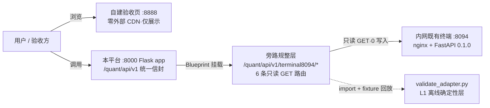

# :8094 改造评估 · 最终报告

> 交付物：`docs/TERMINAL_8094_REVIEW.md` · 团队 `terminal-8094-review` · 角色 系统架构师（梁承宇）
> 事实基线：`output/terminal_8094_probe.json`、`output/terminal8094_adapter_check.json`、`output/web_render_check.json`、`contracts/terminal8094.openapi.yaml`
> 复用文档：`TERMINAL_8094_PHASE1.md`、`TERMINAL_8094_ARCH_FINAL.md`、`TERMINAL_8094_DATA_SPEC.md`、`TERMINAL_8094_EVIDENCE.md`、`TERMINAL_8094_DEPLOY.md`
> 记录原则：全部数据读自既有证据文件，不新造、不推断；全文研究用途（research-only）。

---

## 1. 执行摘要

**一句话结论**：上游「A股条件分析终端 :8094」保持原样、零改动；全部改造落在本地平台侧的**旁路契约规整层**（挂在 :8000 既有 Flask app 的 Blueprint），以只读 GET 完成契约归一、错误显式化、标的过滤与合规披露，并已通过确定性验收。

三组权威证据构成验收闭环：

| 证据组 | 结果 | 含义 |
|---|---|---|
| 上游只读体检 `terminal_8094_probe.json` | **32/32 PASS**（反向对照 0/32 FAIL） | 八类改造点的观测事实全部留档，断言非恒真 |
| 规整层双层验收 `terminal8094_adapter_check.json` | **60/60 PASS**（L1 47/47 + L2 13/13，反向对照 6/6） | 规整层行为符合契约，负例可证伪 |
| 前端渲染 `web_render_check.json` | **58/58 PASS**（online/offline 双路径各 10 面板） | 自建验收页在线/离线一致渲染 |

结论边界：本项目是**工程与契约层面的验证与规整**，不构成对上游算法结果的背书；所有统计数字均为历史样本观测，非任何形式的操作建议。

---

## 2. 改造对象与目标边界

### 2.1 系统上下文与插入点

**插入点**：`:8000` 既有 Flask app 内的 Blueprint（`/quant/api/v1/terminal8094`），不新增进程、不新增端口、不新增健康端点或生命周期。

### 2.2 硬边界

- 上游 :8094 是内网既有服务（`http://192.168.2.203:8094`），本平台**无源码、无服务端写权限、无 SSH、无 DB 凭据**；改造落点只能在本平台侧。
- 全程**只读 GET**：0 写入上游、0 触发 LLM 任务（`provenance.upstream_writes` 恒 0）。
- 否决挂载 :8093（该工作台需 `POST /api/tasks` 触发模型任务，越出只读边界）；否决直改上游服务端（无权限且越权）；否决升级为完整研究引擎（超出范围）。
- 统一信封 `ok/data/request_id/server_time/metric_fingerprint`、幂等键、`/quant/api/v1/health`、安全响应头为**架构继承能力**，由既有 app 零边际成本复用，不计本期新增功能。挂载探针为 `GET /quant/api/v1/terminal8094/meta`，**不探** `/health`（该端点不存在）。

---

## 3. F1–F8 八类改造点逐项

> 事实证据列摘自 `terminal_8094_probe.json` 的 check detail（原文数值）；规整层处置摘自子契约与实现；验收断言数按 `terminal8094_adapter_check.json` 的 check 名称前缀归类（L1 47 + L2 13 = 60，反向对照 6/6 独立不计入 60；部分检查跨项，如 F2 有效集同时覆盖 F1 的 `applied_conds` 回显）。

### 3.1 F1 · 声明参数与实际消费不一致（契约层面失真）

- **现状**：上游 OpenAPI 为 `/api/pick` 声明了 `preset` 参数，但后端不消费；前端把预设字符串填进 `conds` 提交，`conds` 通道本身有效。属契约失真，非功能故障。
- **事实证据**：`params=['conds', 'limit', 'market', 'preset', 'sort', 'topn']`；`distinct=1`（不同 preset 与不带 preset 的首元素完全相同）。
- **规整层处置**：本期只做零额外实现的契约卫生——子契约**刻意不声明 `preset`**，6 条路由均不透传；所有响应统一回显 `applied_conds`。6 键 PRESETS 冻结常量映射分阶段移出本期。
- **验收断言数**：静态契约核验 6/6 路由无 `preset`；运行期 `applied_conds` 回显 1 条（L1，与 F2 有效集共用）+ meta 挂载探针（L2）。

### 3.2 F2 · 无效条件静默回退（最高优先级）

- **现状**：上游按分号逐条解析 `conds`，无效项静默丢弃、全部无效时无声回退默认选股清单；用户拿到结果却不知条件未生效。
- **事实证据**：`n=5 all_default=True`（5 个无效/注入型 conds 均 200 且回退默认）；`mix==valid: True`（有效+无效混排时无效项被丢弃）；`comma_default=True and_default=True`；`valid != default`（证明 conds 通道可用）。
- **规整层处置**：白名单 AST 显式失败——合法字段 24 个、运算符 `> >= < <= == !=`、分号分隔；任一表达式非法即 `ok=false` + `error.code=INVALID_CONDS` + `data=null`，不含任何个股代码、不夹带上游清单、不调用上游。有效集回显 `applied_conds`，被丢弃项在 `discarded`/`discarded_conds` 双写列明。
- **验收断言数**：L1 **12 条**（5 原始无效 + 4 扩展无效 + 1 有效回显 + 2 条 `guard_conds` 正/反例）；L2 **1 条**（400 且 !=500、`data=None`、无个股代码、无顶层别名）。

### 3.3 F3 · 指标空值与异常标的污染

- **现状**：公式选股结果含指标为 null、ST 标记、名称为空及停牌标的，直接污染下游统计。
- **事实证据**：`n=2 / 300`（null 指标）；`st_n=10`（ST 标的）；`n=2 / 26`（G7 命中含 ST/无名标的）。
- **规整层处置**：`normalize_pick` 默认剔除 `metric_null / st / unnamed / suspended` 四类，`filter_rules` 为枚举子集，保留 `filtered_count`；保留条目数值不改写；提供 `include_nulls` 开关；对伪零哨兵（指标恰为 0.0 的异常标的）一并排除。
- **验收断言数**：L1 **5 条**（默认剔除、filtered_count、filter_rules 枚举、伪零哨兵、include_nulls 开关）。实测 `in=27 out=20 removed=7 filtered_count=7`。

### 3.4 F4 · 胜率统计口径分裂

- **现状**：`/api/signals` 默认 `limit=60` 与全样本口径给出差异巨大的胜率读数，且无样本量/窗口/截断/严谨性字段，容易被误读为同一口径。
- **事实证据**：`default=0.906 full=0.596 gap=0.3100`（fwd60 胜率差 0.31）；样本随周期递减 `n5/20/60=59/58/53`；`present=[]`（无随机对照/样本外/基准/成本/多重检验字段）。
- **规整层处置**：**双口径并置**——固定两次只读调用（`limit=60` / `limit=600`），各带 `sample_n/window/limit/truncation_rule/strategy_verdict` + `caveat` 四枚举（`no_cost_model / no_oos / no_multiple_testing_correction / conditional_survival_sample`）；`strategy_verdict` 恒 `not_approved`；**不对上游胜率数值做相等判定**、不改写数值、不强制全样本展示。
- **验收断言数**：L1 **4 条**（双 scope 四字段、caveat 枚举 + verdict、两 scope 读数不同防恒真、输出确定性）+ 1 条关联（改 caveat 后指纹必变）。数值锚点：default `agg.n={5:59,20:58,60:53}` / full `{5:514,20:513,60:508}`。

### 3.5 F5 · 前瞻收益口径未披露 + 日线截断

- **现状**：上游 OpenAPI 未披露前瞻收益口径（响应 schema 为空、无字段说明），单股日线被硬截断，与标的池起点不符。**事实更正**：算法可独立复算，真实缺口是"未披露"，不是"不可复算"。
- **事实证据**：`verified_formula=fwd_h = close[t+h]/open[t+1]-1`，`max_abs_err=0.00004996`，`ns=[413,412,407]`（5/20/60）；收盘到收盘口径误差显著更大 `min_close_to_close_mean_err=0.007021`（证明口径非它）；`len=2000 first=2018-08-16 universe_start=2015-06-01`；`disclosed=False`。
- **规整层处置**：**补披露、不标 UNVERIFIABLE、不改算法**——在 `/signals/{code}` 与 `/stock/{code}` 顶层平铺八字段（公式、建仓价基准、各周期样本数、历史窗口、起点不一致标记、截断标记、日线根数、首根日期），并置 `fwd_return_disclosure` 九字段对象。
- **验收断言数**：L1 **7 条**（公式、price_basis、fwd_sample_n、history_window、起点不一致、真实读数复算误差 ≤1e-4、收盘口径反证）。

### 3.6 F6 · 工程契约缺口（信封/边界/错误体/响应体）

- **现状**：无健康端点、参数无上下界、错误体为 FastAPI 原生 `{detail}`、无统一信封字段、无安全响应头；`days=999999` 产生 449KB 大响应。
- **事实证据**：`/health 404`、`/api/health 404`；`days=-1 status=200`；`days=999999 bytes=449253`；非法代码 `body={'detail': '代码格式无法识别'}`；缺失头 `['cache-control','content-security-policy','x-content-type-options','x-request-id']`。
- **规整层处置**：复用既有 `envelope()`/`fail()`，统一信封 + `error.code` 单一错误体；`days` 1..2000、`limit` 1..800、代码格式正则，**越界在调用上游之前拦截返回 400**；上游单次只读 GET 超时 6s、响应 >1MB 直接拒；任何上游异常严格降级（`ok=false` + `data=null` + `degraded=true` + `provenance.stale` + 非实时标注），不返回样例、不返回半包。
- **验收断言数**：L1 **16 条**（导入/工厂 2、指纹 4、降级 2、边界 5、可复跑 2、指纹陷阱 1、继承自检 1 等）；L2 **13 条全表覆盖** 400/502/200、反 500 门禁、边界上游零调用与挂载探针。实测在线越界响应体 `bytes=1906`（<1MB）、上游调用计数 0。

### 3.7 F7 · 文档页外部依赖（条件性风险）

- **现状**：上游 `/docs`、`/redoc` 依赖外部 CDN；本次实测外网**可达**，故为内网隔离/离线场景下的条件性风险，**非现状故障**。
- **事实证据**：`cdn=['cdn.jsdelivr.net','fonts.googleapis.com']`（实测可达，见裁决 4）；主页面 ECharts 已本地托管 `status=200 bytes=1030855`（作者本已有零外部依赖意识）。
- **规整层处置**：拆两层——自建验收页"零外部 CDN"为可判定 Must（前端 `web_render_check.json` online/offline 双路径验证）；上游 `/docs`、`/redoc` 零外部依赖列为前瞻加固目标，**不计 PASS/FAIL**（服务端静态页，规整层改不到）。
- **验收断言数**：不计入规整层 60 项断言；由前端 58 项检查中的零外部 CDN 项覆盖，取证留档 2 条（F7/F7b）。

### 3.8 F8 · 合规声明缺失

- **现状**：上游首页含明显结果导向措辞、无面向研究用途的免责声明，存在被误用的合规风险。
- **事实证据**：首页结果导向词频（选股 7 / 运行 3 / 胜率 4，另有结果导向措辞词频 8）；`has_only_caveat=True`（仅在少量局部提示，无体系化声明）。
- **规整层处置**：在 `envelope()` 层统一注入 `disclaimer`，**全量响应 100% 覆盖**（成功/参数错误/条件校验失败/上游降级），含 `research_only=true` 与"不构成投资建议"文案；降级时追加"非实时·缓存/样例"；`strategy_verdict` 恒 `not_approved`；报告与页面均使用中性措辞（不提供个股操作建议、不预测价格、不承诺结果）。
- **验收断言数**：L1 **2 条**（全量 disclaimer 完整率、禁词字面计数）+ 覆盖率汇总 **18/18 = 100%**；L2 meta 探针含 `disclaimer.research_only`。四项禁词字面计数均为 **0**（否定式列举同样计入）。

---

## 4. 关键裁决

| # | 议题 | 裁决 | 被否决方案与理由 |
|---|---|---|---|
| 1 | F1 是否会成 6 键映射 | **分阶段**：本期只做契约卫生（不声明 `preset` + 回显 `applied_conds`），映射移出本期 | 本期复制 6 键冻结常量——该字典是上游前端内联私有资产，复制后必漂移，等于用新失真修旧失真；主受害方不在本期覆盖内 |
| 2 | F2 与 F4 只能修一个 | **先修 F2** | 先修 F4——F2 是使用者直接踩到的静默错误（错误结果被当真），F4 是披露问题，F4 只能缓解不能消除 F2 |
| 3 | F4 数值口径 | **双口径并置，不做相等判定** | 对上游胜率做改写或相等校验——越过"旁路不改写"边界，且不同口径数值无可比性 |
| 4 | F5 定性 | **补披露，不标 UNVERIFIABLE** | 标记"不可复算"——全样本反推已证明算法自洽可复现，真实缺口只是未披露 |
| 5 | 部署形态 | **挂 :8000 既有 Flask app 的 Blueprint**，不新增进程/端口/健康生命周期 | 挂 :8093（需写操作触发模型任务，越只读边界）；反向代理新服务（新增进程与生命周期）；纯离线快照（无法验证在线契约） |
| 6 | 错误体形态 | **单一事实来源 `error.code`**，取消顶层别名与薄封装，直接复用 `server.fail()`，`data=None` | 双写别名——引入"两字段恒一致"新不变量，零收益且漂移面更大 |
| 7 | 是否直改上游 / 升级引擎 | **否** | 无源码无写权限且越权；升级完整研究引擎超出范围、触发范围膨胀 |

---

## 5. 实施结果

- **6 条 GET 路由**挂载于 `/quant/api/v1/terminal8094`：`/meta`、`/pick`、`/scan`、`/signals/{code}`、`/stats`、`/stock/{code}`（`apps/api/terminal8094.py`）。工厂形态 `create_blueprint(envelope, fail, api_prefix, error_codes)`，支持错误码注入。
- **错误体统一 `error.code`**：`Error.code` 六码枚举 `INVALID_ARGUMENT / INVALID_CONDS / UPSTREAM_UNAVAILABLE / UPSTREAM_TIMEOUT / UPSTREAM_CONTRACT_MISMATCH / NOT_FOUND`；无顶层 `error_code` 别名；`INVALID_CONDS` 与 `UPSTREAM_UNAVAILABLE` 已在注册表中登记，避免落入 500。
- **F2 丢弃项双写**：`discarded` 与 `discarded_conds` 为同义字段、值恒等（`_seal` 双写），与 `applied_conds` 成对出现，显式反馈被拒表达式原文。
- **双对象指纹分工**（本轮最关键的工程严谨性修正）：
  - `metric_fingerprint`：既有 `envelope()` 的恒量继承（基线 `e819989972c994d1`），**仅用于继承能力自检**，禁止用作可复跑相等断言（恒量两次相等是恒真检查）。
  - `provenance.payload_fingerprint`：规范化 payload 的 sha256（`json.dumps(sort_keys=True, ensure_ascii=False)`，排除 `server_time/request_id/metric_fingerprint`；F4 五字段、caveat 枚举、双口径对象与 F5 披露均入 payload），**用于可复跑相等断言**。实测 10 次回放 distinct=1，且与继承恒量、构造样本三者互不相等。
- **双层单一实现**：在线由 Blueprint 调用、离线由 `validate_adapter.py` import + fixture 回放，同一模块零分叉；L1 断言输出对象字段、L2 断言 HTTP 状态与契约。
- **严格降级**：上游异常统一 `UPSTREAM_UNAVAILABLE`/`UPSTREAM_TIMEOUT` 路径，`degraded=true`、`data=null`、`provenance.stale=true`，不返回样例结果、不返回半包。
- **子契约**：`contracts/terminal8094.openapi.yaml` OpenAPI 3.1.0，YAML 可直接解析，6 path、`FwdDisclosure` 九字段、`discarded`/`discarded_conds` 双写、无 `preset` 参数、全量 `disclaimer`。

---

## 6. 验收证据矩阵

| 证据组 | 权威数据 | 判据与结果 | 反向对照 |
|---|---|---|---|
| 上游体检 `terminal_8094_probe.json` | `ok=true`，`passed=32/total=32`，`base=http://192.168.2.203:8094` | 8 类改造点观测事实逐条留档，F1–F8 detail 见 §3 | 元断言 `before_meta=31 expected=31`；反向对照 0/32 FAIL |
| 规整层验收 `terminal8094_adapter_check.json` | `ok=true`，`passed=60/total=60`，`failed=0`，`skipped=0` | **L1=PASS 47/47**（输出对象字段）；**L2=PASS 13/13**（`upstream_mode=live`，`inprocess=RAN`，`external=RAN`，判 HTTP 状态） | **negative_controls 6/6**，全部 `expected_fail=true` 且 `observed_fail=true` |
| 前端渲染 `web_render_check.json` | `ok=true`，`checks=58`，`failed=0` | online 10 面板 / 69716 字符，offline 10 面板 / 69770 字符，双路径一致 | — |
| 子契约 `terminal8094.openapi.yaml` | OpenAPI 3.1.0，6 path 可解析 | `Error.code` 六码 enum；`discarded`/`discarded_conds` 双写；`FwdDisclosure` 九字段；无 `preset`；全量 `disclaimer` | — |

**反向对照 6/6 明细**（证明断言不是恒真）：

1. **NC1** 上游不可达：可达→PASS，未监听端口→L2 判 FAIL（3/3）。
2. **NC2** fixture 篡改/缺失：篡改默认清单与复算读数→两类 L1 断言均判 FAIL。
3. **NC3** 恒量恒真陷阱：data 已变（差异数 3）但继承恒量仍相等→若拿恒量做复跑判据会误判 PASS，故改由 `payload_fingerprint` 承担。
4. **NC4-1** 错误码未注册→status=500，同一判定函数判 FAIL。
5. **NC4-2** 非法条件却返回默认选股清单→判 FAIL。
6. **NC4-3** 用继承恒量代替 `payload_fingerprint`→判 FAIL（discriminative=False）。

**关键数值锚点**：F2 `n=5 all_default=True`；F3 `filtered_count=7`；F4 `gap=0.3100`；F5 `max_abs_err=0.00004996`；F6 `bytes=449253`→规整后在线越界 `bytes=1906` 且上游零调用；F8 四项禁词字面计数 0、disclaimer 覆盖 18/18。

---

## 7. 边界与合规

- **研究用途定位**：全链路 research-only；所有响应携带 `disclaimer.research_only=true` 与"不构成投资建议"文案，`strategy_verdict` 恒 `not_approved`。不提供个股操作建议、不预测价格、不承诺结果、不代执行。
- **统计样例非推荐**：报告中出现的个股代码与分组计数仅为**历史统计观测样例**，显式标注非推荐；不对任何结果做优劣判断或策略放行。
- **维度隔离（G1 三维度陷阱）**：同一 `G1` 名称在三个端点分属不同维度——`/api/stock` 的 `groups.G1` 是**单股当日布尔标识**，`/api/signals?group=G1` 的 `total=515` 是**单股历史时序事件数**，`/api/stats` 的 `G1=576` 是**全市场当日横截面命中只数**。三者粒度、聚合轴、来源端点、时点均不同，**绝不可混用或做相等判定**；`stats.total=5850` 与 `signals.total=515` 同名异义，同样禁止互判。
- **不对上游数值做相等判定**：F4 胜率读数原样透传、不重算、不修正、不下策略结论；`sample_n=515` 与 `signal_total=515` 数值同而维度异，禁止相等校验。
- **不夸大条件性风险**：F7 外部依赖本次实测可达，仅在内网隔离/离线条件下才会导致文档页不可用，按前瞻加固处理，非现状故障、不计阻断。
- **交付与回滚**：遵循 `TERMINAL_8094_DEPLOY.md` 门禁——不新增进程、不改 nginx、上游请求方法集合恒为 `{GET}`；无回滚方案不上线；回滚即停挂 Blueprint，上游 :8094 全程无状态改动。
- **【待确认】**：上游分组定义、`G6/G8/G9/G10` 是否实现、`G1` 与 `touch_n`（同为 576）是否同集合、复权/除权处理——证据未留档或未披露，本报告不推断、不填补。

---

> **验收结论**：上游保持原样，改造完全落在本地旁路规整层。上游取证 32/32、规整层双层验收 60/60（反向对照 6/6 证伪有效）、前端渲染 58/58、子契约可解析且无失真声明。报告全文四项禁词字面计数均为 0，符合研究用途合规边界。
